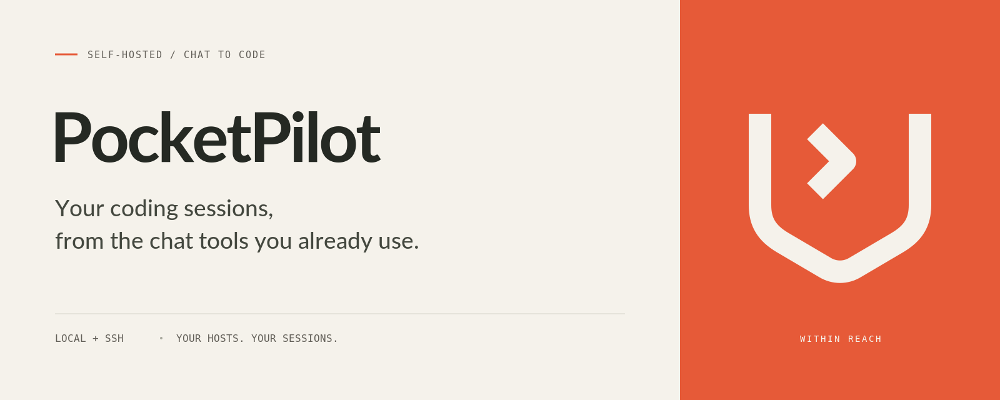

# PocketPilot brand assets

[简体中文](README.zh-CN.md) · [Project README](../../README.md)

The PocketPilot mark is an open pocket containing a terminal chevron. Use the same mark and product name in both languages; localize the supporting copy. The SVGs are editable source files, and the PNGs are ready to publish.



## Asset inventory

Each stem below has an `.svg` source and a `.png` export. Logo SVGs use a 512 × 512 viewBox; all exports use the sizes below.

| File stem | PNG size | Background | Use |
| --- | --- | --- | --- |
| [logo](logo.svg) | 1024 × 1024 | Transparent | Primary vermilion mark |
| [logo-dark](logo-dark.svg) | 1024 × 1024 | Transparent | Ink mark for light backgrounds |
| [logo-light](logo-light.svg) | 1024 × 1024 | Transparent | Ivory mark for dark backgrounds |
| [avatar](avatar.svg) | 512 × 512 | Ivory | Repository or bot avatar |
| [banner.en](banner.en.svg) | 1600 × 640 | Ivory / vermilion | English README or announcement |
| [banner.zh-CN](banner.zh-CN.svg) | 1600 × 640 | Ivory / vermilion | Simplified Chinese README or announcement |

Use lowercase, hyphenated asset names, with a locale suffix before the extension for localized artwork: `banner.en.png`, `banner.zh-CN.png`. Shared marks have no locale suffix. The product name is always **PocketPilot**.

## Color and typography

| Color | Hex | Role |
| --- | --- | --- |
| Vermilion | `#E65A38` | Primary mark and accent panel |
| Ivory | `#F5F2EB` | Light background and reversed mark |
| Ink | `#252923` | Product name and dark mark |
| Body | `#44483F` | Tagline |
| Muted | `#625F58` | Supporting text |
| Rule | `#D6D3CA` | Dividers |
| Dot | `#A7A79C` | Small separators |

Use Lato for the product name and English tagline, Noto Sans CJK SC for Chinese, and DejaVu Sans Mono for English supporting text. Fonts are not embedded or bundled. PNGs preserve the exported appearance; SVG text needs the named fonts or uses system fallbacks. Both project READMEs use PNGs so Chinese typography remains visible without installed fonts.

## Usage

- Preserve the mark's proportions, stroke weight, terminal chevron, and built-in canvas margins.
- Keep at least one stroke width of clear space around the visible mark. At the SVG's native scale, that is 36 units.
- Use a minimum canvas size of 32 × 32 pixels for the standalone mark. Prefer the avatar for square profile images; keep its background and padding intact for circular crops.
- Use the ivory mark on dark or vermilion backgrounds and the ink mark on light backgrounds. The primary vermilion mark works on ivory.
- Scale banners proportionally at their 5:2 aspect ratio. Keep all copy and the symbol visible. Do not stretch, recolor, rotate, add effects, or place the mark on a busy background.
- Use the matching locale and descriptive alt text when embedding a banner. Translate the tagline and supporting copy together.

English tagline: **Your coding sessions, from the chat tools you already use.**

Simplified Chinese tagline: **从你常用的聊天工具，接入不同主机上的 AI 编程会话。**

## Exporting

Edit the SVG sources, then run from the repository root:

```sh
python3 assets/brand/export.py
```

Exporting requires Python 3.10+, CairoSVG, its Cairo system dependency, and Lato, Noto Sans CJK SC and DejaVu Sans Mono installed locally. These are optional artwork tools; building or running PocketPilot does not require them. Ensure the named fonts are available before exporting; missing fonts can silently change the rendered type.

The exporter resolves paths relative to its own location and rewrites all six PNG exports from the corresponding SVG sources. Review both localized banners after exporting. The included assets were rasterized with CairoSVG 2.9.0.

## License

The SVG sources, PNG exports and export script are covered by the repository's [Apache-2.0 license](../../LICENSE). The usage guidance above describes the intended visual identity. Fonts are not bundled; their respective projects maintain their licenses. The project license does not grant trademark rights.
