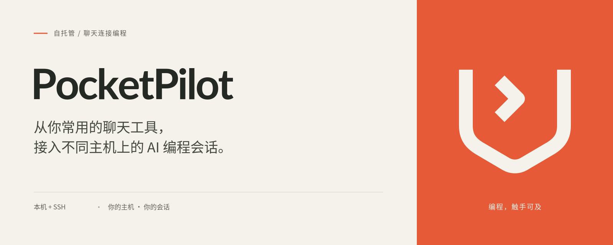

# PocketPilot 品牌资源

[English](README.md) · [项目 README](../../README.zh-CN.md)

PocketPilot 标志由口袋轮廓和终端提示符组成。中英文版本共用标志及产品名称，宣传语和辅助文案按语言本地化。SVG 是可编辑源文件，PNG 可直接用于发布。



## 文件规范

下表每个文件名均有 `.svg` 源文件和 `.png` 导出文件。Logo SVG 的 viewBox 为 512 × 512，PNG 尺寸见下表。

| 文件名 | PNG 尺寸 | 背景 | 用途 |
| --- | --- | --- | --- |
| [logo](logo.svg) | 1024 × 1024 | 透明 | 朱橙主标志 |
| [logo-dark](logo-dark.svg) | 1024 × 1024 | 透明 | 用于浅色背景的深色标志 |
| [logo-light](logo-light.svg) | 1024 × 1024 | 透明 | 用于深色背景的暖白标志 |
| [avatar](avatar.svg) | 512 × 512 | 暖白 | 仓库或机器人头像 |
| [banner.en](banner.en.svg) | 1600 × 640 | 暖白 / 朱橙 | 英文 README 或项目介绍 |
| [banner.zh-CN](banner.zh-CN.svg) | 1600 × 640 | 暖白 / 朱橙 | 中文 README 或项目介绍 |

文件名使用小写英文与连字符，本地化资源在扩展名前添加语言标记，例如 `banner.en.png`、`banner.zh-CN.png`。共用图形不加语言标记。产品名称统一写作 **PocketPilot**，不另造中文名。

## 色彩与字体

| 色彩 | 色值 | 用途 |
| --- | --- | --- |
| 朱橙 | `#E65A38` | 主标志与强调色块 |
| 暖白 | `#F5F2EB` | 浅色底与反白标志 |
| 墨色 | `#252923` | 产品名与深色标志 |
| 正文色 | `#44483F` | 宣传语 |
| 辅助色 | `#625F58` | 辅助文案 |
| 分隔线 | `#D6D3CA` | 细分隔线 |
| 分隔点 | `#A7A79C` | 小型分隔符 |

产品名和英文宣传语使用 Lato，中文使用 Noto Sans CJK SC，英文辅助文案使用 DejaVu Sans Mono。字体不嵌入、不随资源打包。PNG 固定保留导出时的字形；SVG 文字依赖本机字体，缺失时使用系统回退字体。两份项目 README 均引用 PNG，避免中文字体缺失影响展示。

## 使用规则

- 保持标志比例、线宽、终端提示符及画布内置留白。
- 标志可见轮廓外至少保留一个线宽的净空；在 SVG 原始尺度下为 36 单位。
- 独立标志建议最小画布为 32 × 32 像素。方形头像优先使用 avatar，保留背景和留白，兼容圆形裁切。
- 深色或朱橙背景使用暖白标志，浅色背景使用深色标志；朱橙主标志可用于暖白底。
- 横幅按 5:2 等比缩放，完整保留文案与图形。不拉伸、改色、旋转、添加特效或置于复杂背景上。
- README 使用对应语言横幅并提供描述性替代文字。宣传语和辅助文案应一并本地化。

英文宣传语：**Your coding sessions, from the chat tools you already use.**

中文宣传语：**从你常用的聊天工具，接入不同主机上的 AI 编程会话。**

## 重新导出

编辑 SVG 后，在仓库根目录执行：

```sh
python3 assets/brand/export.py
```

导出需要 Python 3.10+、CairoSVG、对应 Cairo 系统依赖，以及本机安装的 Lato、Noto Sans CJK SC、DejaVu Sans Mono。这些仅用于编辑图片，PocketPilot 的构建与运行不需要它们。导出前确认字体可用，字体缺失可能导致字形被静默替换。

脚本按自身位置解析资源路径，将六张 SVG 重新导出为对应 PNG。导出后检查中英文横幅。当前 PNG 使用 CairoSVG 2.9.0 导出。

## 许可

SVG 源文件、PNG 导出与导出脚本采用仓库的 [Apache-2.0 许可证](../../LICENSE)。上述使用规范用于保持视觉一致性。字体不随仓库分发，其许可由各字体项目维护。项目许可证不授予商标权。
