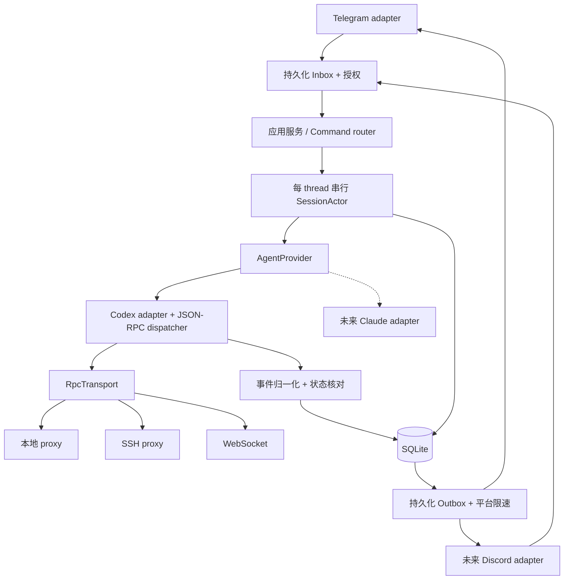
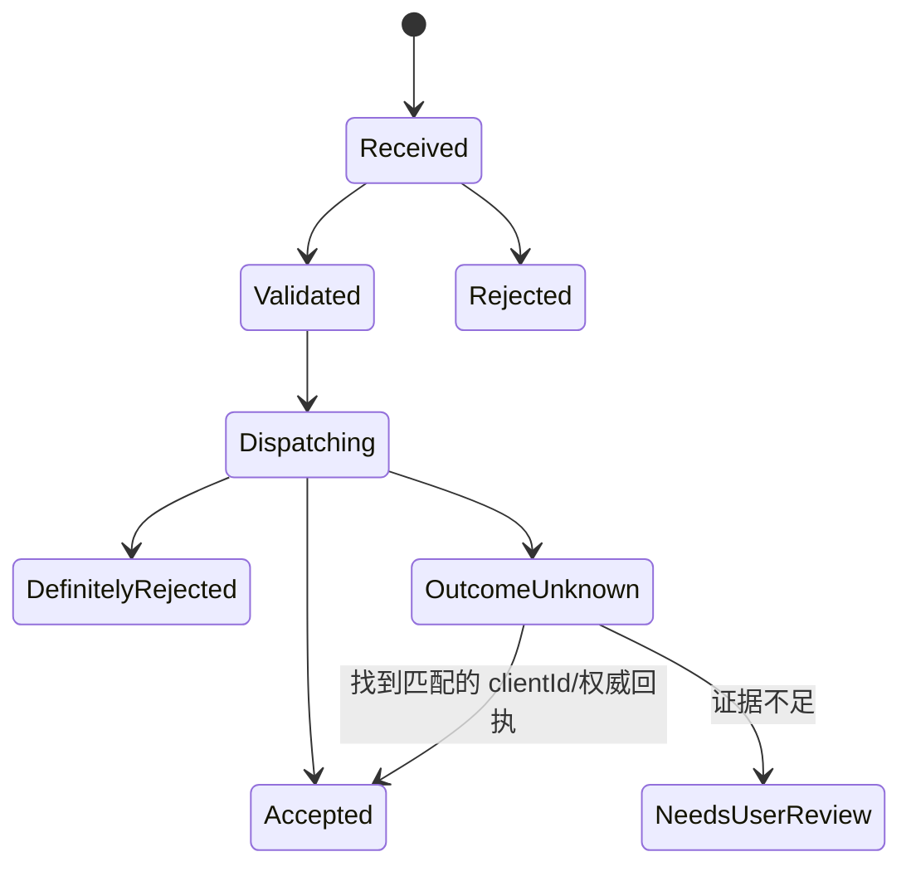

# 02 · 架构、Rust 接口与数据设计

状态：建议实施的设计契约，非已实现代码。接口示例用于约束责任；命名和少量类型可在实施时调整，但生命周期与安全约束不能弱化。

## 1. 架构目标

PocketPilot 是会话的附加客户端和聊天平台桥接器。Codex 继续拥有 thread、turn、任务执行、历史与审批状态；PocketPilot 只拥有地址映射、平台交互、投递记录和本地观察缓存。

边界独立于三个变化方向：

- AgentProvider：Codex/未来 Claude 的会话行为。
- ChatPlatform：Telegram/未来 Discord 的用户交互和消息投递。
- RpcTransport：本地 proxy、SSH proxy、WebSocket 的连接和 framing。

运行时采用单进程 Tokio 服务、SQLite 持久化和 bounded actor 队列。MVP 不需要 Redis、Kafka、HTTP 管理后台、动态插件 ABI 或分布式调度。



## 2. 领域模型与地址

| 概念 | 定义/唯一性 |
| --- | --- |
| Host | 本地或 SSH 机器；UUID 是身份，显示名和 SSH alias 可变 |
| ProviderInstance | 某 host 上一个确定的 agent 服务；provider kind + 本地配置身份，不按 cwd 建实例 |
| Workspace | PocketPilot 登记的项目入口：instance + 主 cwd + 明确允许的关联 cwd/worktree |
| SessionRef | `instance_id + provider_thread_id`；不以新协议 sessionId 作主键 |
| TurnRef | session + provider turn ID；用于 steer 前置条件 |
| ConversationBinding | 某平台的容器地址到一个 SessionRef 的绑定 |
| PlatformAddress | Telegram `(chat_id, message_thread_id)`；Discord `(guild_id, channel_id)` |
| Observation | 服务端状态 + active turn + 连接 epoch + 观察时间 + freshness |
| TextItem | session + turn + item ID + role/phase + 可见文本 + 完成标记 |
| Operation | 用户一次操作的持久化 ID、输入地址、执行模式、结果与不确定性 |
| PendingRequest | agent 发来的审批/输入请求；仅当前连接 epoch 可回答 |

同一远程 thread 在不同 host/provider 中可同名；ID 不跨实例合并。instance 的 runtime ownership 需要受测连接 profile 和安装记录验证。initialize 不提供通用、可靠的进程身份认证；不能靠响应版本字符串证明两连接属于同一进程。

MVP 禁止同一平台容器地址改绑到不同 SessionRef：解绑后保留地址墓碑，只能重新连接原 session；更换 session 必须创建新 topic/channel。这样迟到的普通消息不能落入另一个会话。binding revision 仍用于同一 session 的解绑/恢复操作和旧按钮失效。

MVP 允许同一 session 在每个已授权平台目标中各有一个绑定；同一 Telegram 群内重复绑定直接返回已有 topic。会话执行锁跨这些绑定共享。后续跨平台输入只转发一次，并保留来源；不让机器人回声重新进入 agent。

Workspace 主路径只在对应 host 上解析，不能在 PocketPilot 机器上 canonicalize 远程路径。保存用户录入值和经目标端确认的规范值；没有可靠的只读路径验证接口时要求显式路径配置。执行工作区关联的增改时不调用 agent 任意命令工具。

## 3. Rust 接口

### 3.1 Provider 能力

能力由**受测版本 profile + 当前连接实际结果 + 部署验证结果**共同决定，不能只看 semver。Schema 文件用于构建/诊断，MVP 不在运行时下载并执行未知版本 Codex。

```rust
pub struct ProviderCapabilities {
    pub list_sessions: bool,
    pub history: HistorySupport,
    pub observe_live: bool,
    pub join_running_without_restart: bool,
    pub steer: bool,
    pub multi_client: bool,
    pub survives_client_disconnect: bool,
    pub correlation_ids: bool,
    pub request_support: RequestSupport,
}

pub enum HistorySupport { Legacy, Paginated, Unavailable }
pub enum JoinPolicy { LoadedOnly, AllowLoadStored }
pub enum SendMode {
    Continue,                      // 当前上下文或下一轮；由应用服务解析
    SteerExact { turn: TurnId },    // 不得默默跨 turn
}

#[async_trait::async_trait]
pub trait AgentProvider: Send + Sync {
    fn capabilities(&self) -> ProviderCapabilities;
    async fn list_sessions(&self, query: SessionQuery)
        -> Result<Page<SessionSummary>, ProviderError>;
    async fn snapshot(&self, session: &SessionRef)
        -> Result<SessionSnapshot, ProviderError>;
    async fn history(&self, query: HistoryQuery)
        -> Result<Page<TextItem>, ProviderError>;
    async fn join(&self, session: &SessionRef, policy: JoinPolicy)
        -> Result<SessionSnapshot, ProviderError>;
    async fn create(&self, request: CreateSession)
        -> Result<SessionSnapshot, ProviderError>;
    async fn send(&self, request: SendRequest)
        -> Result<SendReceipt, ProviderError>;
    async fn answer(&self, request: PendingRequestRef, answer: UserDecision)
        -> Result<AnswerReceipt, ProviderError>;
    async fn release_observation(&self, session: &SessionRef)
        -> Result<(), ProviderError>;
    fn take_events(&self)
        -> Result<futures::stream::BoxStream<'static, ProviderEvent>, ProviderError>;
}
```

`take_events` 是实例级单消费者事件源，第二次调用明确失败。创建 stream 后再列/加入 session，避免事件丢失；事件汇聚器按 session 分发。断线在同一 stream 中产生连接事件，连接 supervisor 负责重建底层 transport；不会偷偷创建新 agent 服务。

`join` 的定义：只加入该实例原 thread；LoadedOnly 不能在另一个实例冷启动同历史 thread。AllowLoadStored 仅在已验证共享实例、用户明确继续历史会话时允许加载。provider 的 snapshot 不隐式 join。`release_observation` 只释放本桥接器观察，在活跃或待请求时延迟 explicit unsubscribe；连接退出由受测服务保证工作存活。

当前查阅的 Codex resume 没有原子的“仅 loaded 才 join”前置条件；先 loaded/list 再 resume 存在 TOCTOU。因此 Codex MVP 的严格 LoadedOnly 返回 Unsupported，不能伪装实现。实际连接按钮说明“加入原会话，必要时加载历史”，用户明确授权后才使用 AllowLoadStored，并持久化 `allow_reload_on_reconnect`；未授权冷加载的重连只能只读观察/请求确认。可信单实例的 warm-first 分支保证加入尚在运行的原对象；这是与 loaded-only 不同的保证。

接口**没有 stop、interrupt、kill、rollback、fork、archive 或服务重启**。create 必须使用登记 Workspace 和明确的新会话配置；不能用它实现 resume。现有会话的 SendRequest 不含 model/cwd/sandbox 覆盖字段。

`UserDecision` MVP 只支持单次批准和对应请求的用户回答；没有 Cancel、Decline、AcceptForSession。稍后处理是本地 UI 动作，不发送 provider decision。批准是真实用户操作，不是桥接器自动决策。

### 3.2 Provider 事件与错误

事件至少包含 instance、connection_epoch、session、provider 原始对象 ID 和 observed_at：

```text
ConnectionChanged { connected / recovering / offline / incompatible }
SessionObserved { state, active_turn_id?, freshness }
TextItemObserved { turn_id, item_id, role, phase?, text, final }
TurnEnded { turn_id, completed / failed / interrupted }
UserRequestOpened { scoped_request_id, kind, safe_summary }
UserRequestResolved { scoped_request_id }
HistoryGapDetected { scope, reason }
CapabilityChanged { restricted_reason }
```

错误区分 `Unsupported`、`NotAuthorized`、`NotConnected`、`StaleObservation`、`TurnConflict`、`NotSteerable`、`DefinitelyRejected`、`OutcomeUnknown` 和服务端错误。业务层不得对所有错误统一 retry。

Codex wire enum 接受未知扩展并保留安全诊断信息，未知事件不让全服务 panic；未知运行状态立即变为 Unknown，不能映射 idle。新增只读字段可忽略，但审批类型、执行语义等未知行为必须限制控制能力。

### 3.3 平台接口

```rust
#[async_trait::async_trait]
pub trait ChatPlatform: Send + Sync {
    fn capabilities(&self) -> PlatformCapabilities;
    async fn create_container(&self, spec: ContainerSpec)
        -> Result<ContainerReceipt, PlatformError>;
    async fn rename_container(&self, target: PlatformAddress, title: &str)
        -> Result<(), PlatformError>;
    async fn deliver(&self, message: Delivery)
        -> Result<DeliveryReceipt, PlatformError>;
    async fn update_status(&self, card: StatusCard)
        -> Result<(), PlatformError>;
    async fn acknowledge_action(&self, action: PlatformActionRef)
        -> Result<(), PlatformError>;
}
```

Inbound 由 adapter 自己接收，再转成统一的 `UserCommand` envelope；它包含用户、平台地址、稳定外部 update/message ID、平台发送时间、本地接收时间、绑定修订号、接收时的连接 epoch。平台接口不暴露 provider 的 wire JSON。Topic 与 Discord channel 都是 session container，但 Telegram 控制菜单、Discord category 是 adapter 的表现细节。

消息长度、可编辑/固定能力、按钮限制在 PlatformCapabilities；core 传可见文本/结构化状态，adapter 分片和渲染。未来不能为 Discord 把 Telegram message_thread_id 强行映射成通用整数。

### 3.4 RpcTransport

传输层只连接、收发 wire 消息和报告连接终止。Codex adapter 拥有 JSON-RPC dispatcher，负责 ID、pending map、超时、双向请求、版本 profile 和事件解析。

发送器的请求方法使用强类型 `AllowedCodexRequest` enum，不允许上层传任意 method 字符串。基础白名单：initialize、thread/list/read/loaded/list/resume/start、适用版本的历史 API、turn/start/steer。延迟 unsubscribe、必要的只读诊断方法需单独审计。响应服务端 request 走单独的强类型回复通道，不能用“白名单不含审批方法”为由丢弃请求。

禁止路径包括 `turn/interrupt`、thread rollback/revert/delete/archive/fork/compact、backgroundTerminal terminate/clean、process kill、shellCommand、command/exec、写配置/写文件、daemon stop/restart、给 agent PID 发信号。程序不提供原始 RPC 透传命令。

## 4. 运行时与任务所有权

每个 provider instance：一个 ConnectionSupervisor、一个读循环、一个有界写队列、一个 RPC dispatcher 和事件归一化器。SSH 每个 host 复用连接；不同 instance 的 agent 会话不按工作区重复初始化。

每个已绑定 session：一个 actor，序列化 PocketPilot 的发送、审批、状态核对和 binding 变更。等待 RPC 的过程中继续接收事件与服务端 request；不能拿全局 Mutex 等网络。

取消 token 分两级：PocketPilot 服务级和**本地连接任务级**；都不能转换成 agent interrupt。SSH/proxy 子进程是桥接器所有，daemon/agent 子进程不是。退出可以回收本地 proxy，但必须先确认连接消失不会触发任务取消的受测保证。

队列原则：

- 核心 user/agent 文本、请求与决议落盘，不静默丢弃。
- delta 可合并为 item 最新文本；状态卡更新允许合并。
- stdout/stderr 工具事件在解析层过滤，不持久化海量工具正文。
- 数据库异常/磁盘满：停收新的控制操作，保持读取连接并尽力保留必要通知；报警，不向 agent 发 cancel。
- 不让 Telegram HTTP 限速阻塞 app-server 读循环。

## 5. 状态模型与一致性

不使用单一 running 字段。保存四组正交信息：

| 维度 | 值 |
| --- | --- |
| 连接 | Connected / Recovering / Offline / Incompatible |
| thread runtime | NotLoaded / Idle / Active(flags) / SystemError / Unknown |
| active turn | turn ID、kind（若可得）、status、观察时间 |
| 最近 turn 结果 | Completed / Failed / Interrupted / None |

运行状态仅服务端权威。Telegram 发送成功不能把状态直接改成 active；RPC 接受回执也只更新操作状态，再由响应快照/事件收敛实际 runtime。

Freshness 保存 observed_at 和连接 epoch。推荐新鲜状态窗口 15 秒，绑定会话定期低频核对（默认 30 秒，带 jitter，按实例限流）；发消息前主动核对，必要时获取 live turn 快照。超过窗口可显示“最后状态”，控制需要最新核对，不把 silence 当完成。

快照/事件竞态处理：每次重连提升 epoch，旧 epoch 事件作废；join 前就开始 buffer 新事件。适配受测版本的 resume 响应与通知顺序，再合并 buffer；发现冲突时重新读状态/活跃 turn。没有通用服务端全局 revision，不能用本地 receive time 或 updatedAt 当强一致版本号。历史 item 通过 ID 与完成标志合并，completed 文本优先于 delta。

活跃 turn ID 来自受测版本的 live resume snapshot、turn/started 或支持 live 状态的 turns API。metadata-only resume 的 active 标记不保证带 turn ID。拿不到 ID 时显示“运行中，暂不能追加”，不猜 ID、不用时间最新的已完成 turn 代替。

## 6. 持久化

SQLite WAL、foreign_keys=ON、busy_timeout，短事务；单机单写者部署。迁移由 sqlx 管理；数据只存 PocketPilot 目录，不修改 Codex DB/rollout。TOML 管静态 host/路径/策略，DB 管运行期注册与绑定；配置 ID 是稳定 UUID，两者重名冲突启动时报错，不静默覆盖。

建议表：

| 表 | 主要字段/约束 |
| --- | --- |
| hosts | id、display_name、transport_profile_ref；不存私钥/token |
| provider_instances | id、host_id、kind、endpoint_ref、tested_profile、ownership_verified_at |
| workspaces / workspace_paths | id、instance_id、display_name、primary_cwd；附加 cwd 显式登记 |
| sessions | instance_id + external_thread_id 唯一；workspace_id、title、status、last_observed_at、epoch |
| bindings | platform、tenant/chat、container/topic、session_key、revision、mode；容器地址唯一 |
| inbound_updates | bot_instance + polling_epoch + external_update_id 唯一；stable_event_key、payload、platform_sent_at、ingested_at |
| platform_offsets | bot_instance、polling_epoch、last_durable_update_id、last_update_received_at、last_update_generation_lower_bound、cursor_mode |
| operations | operation_id、stable_event_key/action_nonce 唯一、session_key、binding_revision、connection_epoch、mode、expected_turn_id、state、receipt/error |
| text_items | instance/thread/turn/item 唯一；role、phase、canonical_text、final、client_id |
| deliveries / outbox | binding、item、render_revision、chunk_index 唯一；payload、state、next_attempt_at、platform_message_id |
| pending_requests | instance + epoch + rpc_request_id；session、turn、kind、resolved、reply_state |
| ui_actions | opaque nonce、authorized user/chat、binding revision、operation scope、expiry、used_at |
| provisionings | operation_id、desired session/topic、known external IDs、state/unknown_reason |

Telegram chat ID 使用 i64；topic/message ID 用框架类型边界检查。Discord snowflake 在统一持久层存字符串或无符号安全编码，避免有符号溢出。JSON-RPC request ID 保留 string/integer 类型，不统一 parse 成整数。

SQLite 中的文本仍可能含源码和个人信息。目录权限限制本机用户；日志不复制正文。默认保留未投递内容，已确认文本缓存可按 30 天配置清理，映射/操作幂等记录按独立策略保留。不能因缓存清理自动从历史再次推送旧消息；保留投递水位与稳定 ID 墓碑。

## 7. 入站操作：不重复控制 agent

Telegram long polling 由一个受控 poller 负责：接收批次 → inbox + offset 同事务持久化 → 下一次 getUpdates 才使用更高 offset。不能直接假设框架 dispatcher 的内存 offset 提供持久化确认。重复 update 命中唯一键，不再执行副作用；处理完与否不决定是否可确认网络 update，**落盘**才决定。

Telegram 在至少一周无新更新后，下一 update_id 可以重新随机选择，不能把 offset 当永久递增计数。不能从“本地收到更新”起计该窗口，因为更新可能已在服务端等待近 24 小时并经历传输延迟。记录产生该批次的请求开始时间，以“请求开始时间减 24 小时、再扣时钟裕量”作为最近更新生成时间的保守下界；只在这个下界起 5 天的保守窗口内使用已持久化 offset。超过窗口、时钟不可信或恢复时无法确认 cursor 时代，立即切换成不传 offset 的 polling，直到拿到新批次。批次落盘后在新的 polling epoch 中建立 cursor，不能继续使用历史最大值，否则可能确认掉较小的新 ID。不使用负 offset 丢弃队列。普通 message 的 stable_event_key 用 bot/chat/message/kind，callback 用 callback_query.id，副作用按该稳定来源去重，避免更换 polling epoch 后重放同一操作。游标重建和跨 epoch 去重需要专门实测。

普通文本在 dispatch 前再次校验 binding revision、epoch、状态和消息年龄。进程启动/网络恢复前产生的消息、经过离线区间的已保存输入，以及超过最大输入等待期的消息（建议初值 120 秒）只保存草稿，必须重新确认。平台时间以秒计时，切换边界含同秒消息保守进入确认；时钟明显不可信也要求确认。接收时已捕获 active turn ID 的操作不得跨 turn 自动转投；状态变化按 steer 冲突处理。已确认为 idle 的普通 Continue 输入保留已说明的 start-or-steer 竞争语义。

操作状态机：



RPC 写入前事务记录 Dispatching。进程崩溃遗留 Dispatching 按 OutcomeUnknown 处理，不能重置为未发送。Accepted 表示输入已接受，不表示 agent 工作已完成。用户输入原文保留在 operation 以便核对；clientId 可关联 platform message，避免回声。

对确定尚未写入 transport 的失败，可以安全重试；已写但未知的失败不得自动重试。服务明确拒绝 overloaded 等错误是否保证未执行，由受测错误分类确定；只读请求指数退避重试。精确 steer 冲突保留原文本和 turn 条件供用户重新选择。

## 8. 出站文本与 Telegram 一致性

`TextItemObserved` → upsert 权威文本 → 计算 delivery intent → 同一事务写 outbox。Sender 独立限速投递，成功保存 message ID。按 session/turn/item 序列展示，外部 agent 没有可证明全局顺序时按服务事件/历史顺序保持，不用 ID 字典序假定时间顺序。

本 topic 用户消息已经在 Telegram 可见，匹配 clientId 后只补“已送达”状态，不再原样复读。CLI/desktop 发来的 userMessage 加来源标签转发；未知来源标为“Codex 用户”，不凭文本相同判定回声。多平台绑定时只排除原始输入位置，其他授权位置仍可同步。

默认等 item/completed 后发送完整文本，保留每个可见 item；可选低频 draft 编辑以后再开。断线补发通过 `(instance,thread,turn,item,revision,chunk)` 去重；历史 revision 变化更新既有可编辑消息，无法编辑则发送明确更正，不冒充新消息。

delta 的最新观察值也需保留为未完成 item。收到 turn 结束但 item 未 completed、服务退出或断线超过核对期限时，先查询历史权威值；无法补齐则发送已知文本并标“未完成，截至某时”，以后获得 completed 再更新同一 delivery。不能为等 completed 永久隐藏已见文本，也不把本地 partial 冒充权威最终回答。

Telegram sendMessage 没有本文可依赖的应用层幂等键。网络超时可能“已经发出但没拿到 ID”，因此只能做到本地去重 + 对已知成功幂等。结果未知的发送进入 DeliveryUnknown，状态卡提示可能缺失；不无限重试制造重复。用户可显式重投并看到“可能重复”的说明。已知 429 等明确拒绝可遵循 retry_after 重试。

create topic、create thread 也不是跨系统事务：使用 provisioning saga 保存每步已知 ID；重复按钮只查询同 operation。未知创建结果不再自动 create，提示核对孤立资源。MVP 不依赖 Telegram 提供完整 topic 枚举接口；管理员可以手动重新绑定已知 topic ID。

## 9. 重连与故障恢复

连接状态：Disconnected → Connecting → Initializing → Reconciling → Ready；任一步失败进 Backoff。采用 backon 全抖动指数退避，起始约 1 秒、上限 60 秒；运行一段稳定时间后重置。认证失败/host key mismatch/不兼容是需人工处理，不频繁重试。

重连流程：

1. 增加 epoch，所有原状态标 stale；原连接在途写操作标 OutcomeUnknown。
2. 重新连接 proxy/endpoint，initialize；只建立一个受控读循环。
3. 恢复已绑定 session 的观察，优先 warm join；检查持久化的加载授权，不能把先前 loaded-only 意图自动升级为冷恢复授权，也不能为同历史 thread 启新服务。
4. 核对 active turn、状态、pending requests；只用新 epoch 的请求回答。
5. 从分页历史重叠读取上次末尾及当前 active turn 的 items，upsert 去重；历史水位不能只用时间戳。
6. 若无稳定 cursor/历史可能变化，从较早锚点重新分页并按 ID 去重；不能假设翻页只追加不更新。
7. 无法证明断线区间连续性时就生成“可能遗漏消息”的 gap 提示，不要求先找到具体缺项；即使历史回补没发现缺项也不能显示完整覆盖。所有 gate 满足后才恢复新输入，积压旧输入仍需确认。

SSH keepalive用于探测连接，无法保证服务永不中断。丢失 SSH 连接只重建 proxy；不杀 daemon、不重启 Codex、不 fork。监督器只回收自己启动的连接进程。服务端真的退出时显示离线并保留未确认操作，等待人工修复。

## 10. 扩展边界

Claude 后续 adapter 必须自行证明列会话、真实 live 状态、可追加输入、断线存活等能力；没有 steer 的 provider 返回 Unsupported，不以“停止再 resume”模拟 steer。Claude 的运行 SDK/权限模型在该阶段独立调研，本文不声称与 Codex 等价。

Discord adapter 把 workspace 映射为 category、session 为 text channel，使用同样的 inbox/operations/outbox。平台拥有能力多不代表 provider 可停止；管理员权限不绕过应用的 host/workspace 授权。

## 11. 日志与诊断

统一 tracing，tracing-subscriber JSON 输出，RUST_LOG 控制级别；第三方 log 日志桥接到 tracing。span 字段含 operation_id、instance_id、内部 workspace_id、thread/turn/item ID、epoch、method、耗时、结果分类。用户/平台 ID 可在日志中哈希化，避免泄漏聊天范围。

禁止默认记录 token、Authorization、完整 URL（Telegram token 在 URL path）、SSH 命令展开后的秘密、全文、配置内容、原始 RPC body、工具输出。错误显示结构化错误码和经清理摘要，不直接打印 reqwest/teloxide 的含 token URL。DEBUG 也必须脱敏。

诊断包含重连次数/原因、状态年龄、队列深度、未决审批数、OutcomeUnknown 数、outbox 最老等待时长、429 和投递失败。MVP 通过日志和 CLI doctor/status 展示；以后再加 metrics endpoint。health “进程活着”与 “provider 可控制”分开报告。
