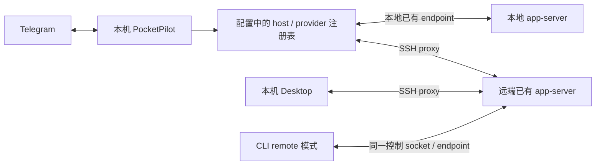

# 06 · 部署、配置热更新与 SSH / OTP

本次补充把本机运行作为默认部署方式，并将所有设置收敛到配置文件。本文与修订后的 01–04 一起构成当前设计；旧研究快照只代表当时观察，不能作为必须兼容旧 CLI 的要求。

## 1. 本机控制入口与远程运行身份

用户提供的部署事实：本机已有 Codex 桌面/app-server 体系，管理本机和多台 SSH 主机上的任务。PocketPilot 默认也在本机运行，但 host、provider endpoint 和平台 adapter 都可配置，不能把 localhost 写进领域层。

这套体系是一个本机入口加多个执行实例，不能未经验证就理解成一个本地 JSON-RPC endpoint 会代理所有远程会话：



如果未来发现公开的本地聚合路由 API，可新增 `DesktopGatewayTransport`，但它仍要报告实际执行 host 和 instance。MVP 直接并行连接允许列表中的各实例，聚合会话列表；不能依赖桌面私有进程 IPC、复制其 TCP 连接或从日志抓取凭据。

SSH 的共享条件是：相同远程用户、相同有效 CODEX_HOME/控制 socket、相同 daemon，CLI 使用 remote 模式连接它。普通 SSH 后直接运行独立 `codex` 命令不自动保证共享。桌面与 PocketPilot 可以各开 SSH 连接，传输连接不同不影响共同使用同一个远端 daemon。

“所有任务”指所有**配置允许、可连接的实例和 workspace**里的会话，分页读取并明确归档/子 agent 过滤；不是读取 ssh_config 中所有主机、自动登录全部服务器或扫描整台远端机器。

## 2. 只支持当前 Codex 协议

MVP 以实施时最新、通过测试的 Codex 版本为唯一基线，不投入旧版 legacy history 兼容。PATH CLI、桌面内置 runtime、远程 CLI/daemon 需要核对实际运行版本；升级安装文件不代表已运行 daemon 自动变成新版。

允许在专门维护步骤升级所需 CLI，但 PocketPilot 不在连接、重连、配置 reload 或自身启动时执行升级/daemon restart。涉及活跃服务的版本切换安排在任务自然完成后的维护窗口，不能为满足新版本要求中断会话。本次只修改设计，没有执行升级。

验收记录版本号、schema hash、实际 daemon 版本与 runtime identity；较新的未验证版本可先只读，不能因为“只支持最新”就省掉行为验证。

## 3. 所有设置来自 config

采用 `pocketpilot.toml`，支持显式 `include` 的 TOML 文件；不加载 `.env`，不要求 `token_env`、RUST_LOG 或其他业务环境变量。CLI 只选择 config 路径，不另造一套配置覆盖优先级。Codex/Claude 本身已有的登录配置不由 PocketPilot 复制或改写。

可将秘密直接写入主 config，也可放入受权限控制的 `secrets.toml` 后 include，二者都是配置文件。TOTP secret 与 bot token 用 secrecy 类型持有，文件要求仅当前用户可读，日志和错误不得输出值。仓库只提交不含有效凭据的 example。

配置是 hosts、workspaces、允许用户、平台账号、速率和 SSH 策略的唯一权威。SQLite 保留绑定、投递、操作结果和 config 派生索引，不作为另一份可独立修改的授权源。

Telegram 的“添加工作区”和本地 `workspace add` 通过统一 ConfigWriter 更新配置，再走同一热更新流程；不能只写 DB。ConfigWriter 只改非秘密的 workspace 段，验证允许根路径与 user 权限，使用配置 revision 比较、文件锁、同目录临时文件 + 原子 rename，保留文件权限；并发编辑冲突时拒绝覆盖。管理员手工编辑仍受支持。配置中的 host 不能由聊天输入任意 shell 命令创建。

示例仅是设计草案，不代表程序已实现：

```toml
include = ["./secrets.toml"]

[service]
data_dir = "/absolute/path/to/pocketpilot-data"

[logging]
format = "json"
filter = "info,pocketpilot=debug"
directory = "/absolute/path/to/pocketpilot-logs"

[telegram]
token = "EXAMPLE_ONLY_REPLACE_IN_PRIVATE_CONFIG"
allowed_chat_ids = [-1001234567890]
allowed_user_ids = [123456789]
control_topic_id = 100

[[hosts]]
id = "00000000-0000-4000-8000-000000000001"
name = "慢速开发机"
transport = "ssh_proxy"
backend = "auto"
ssh_alias = "pilot-dev"
codex_bin = "/absolute/path/to/codex"
codex_control_socket = "/absolute/path/to/app-server-control.sock"
allowed_workspace_roots = ["/srv/code"]

[hosts.timeouts]
connect_seconds = 90
authenticate_seconds = 120
proxy_ready_seconds = 120
rpc_read_seconds = 60
rpc_write_receipt_seconds = 60
keepalive_seconds = 30
keepalive_missed = 6
reconnect_initial_seconds = 2
reconnect_max_seconds = 120

[hosts.authentication]
methods = ["public_key", "keyboard_interactive"]
private_key_passphrase = "EXAMPLE_ONLY"
password = "EXAMPLE_ONLY_IF_REQUIRED"
max_attempts = 2

[hosts.authentication.totp]
secret_base32 = "EXAMPLE_ONLY_NOT_A_VALID_SECRET"
algorithm = "SHA1"
digits = 6
period_seconds = 30
minimum_remaining_seconds = 5
prompt_patterns = ['(?i)^verification code:\s*$', '(?i)^otp:\s*$']
password_prompt_patterns = ['(?i)^password:\s*$']

[[providers]]
id = "00000000-0000-4000-8000-000000000002"
host_id = "00000000-0000-4000-8000-000000000001"
kind = "codex"
connection_mode = "existing_proxy"
compatibility_profile = "latest-tested-codex"

[[workspaces]]
id = "00000000-0000-4000-8000-000000000003"
provider_id = "00000000-0000-4000-8000-000000000002"
name = "PocketPilot"
short_name = "PP"
cwd = "/srv/code/PocketPilot"
additional_cwds = []

[config_reload]
enabled = true
debounce_ms = 500
periodic_rescan_seconds = 30

[delivery]
burst_window_ms = 2000
burst_threshold = 3
max_flush_delay_ms = 5000
telegram_group_messages_per_minute = 18
history_active = "full_bundle"
history_idle = "last_user_and_final"
overflow = "single_document"
```

示例的秘密只为表达字段，不会通过解析校验。methods 是认证策略候选与顺序，最终要遵循服务器 remaining_methods/partial_success；不能认为列出两项就必然需要两项。

实际配置推荐只写 ssh_alias，继承本机 SSH config 的 hostname/user/port/identityfile/known_hosts；不重复维护。backend=auto 在本例因为配置了 TOTP 而选择 russh。所有设置来自配置文件也包括用户已有的 ~/.ssh/config，OTP seed 仍由 PocketPilot TOML 明确提供。prompt pattern 使用 TOML 单引号 literal string，正则空白符只写一个反斜杠的 \s，不再额外转义。

## 4. 配置热更新

`notify` 监听主文件、include 文件、SSH config 及其 Include 文件和父目录的原子替换事件；debounce 后解析完整文件集合，周期 rescan 修复丢失事件。`arc-swap` 原子替换已验证的 immutable ConfigSnapshot，每个操作捕获 config_generation。include 循环、ID 冲突、缺失引用、非法路径/速率/OTP 配置均拒绝整份候选，继续使用最后有效配置。

两阶段：先完整解析/静态验证/建立变更计划，再原子提交配置与授权快照；外部 SSH 建连失败只让该 host degraded，不撤销已经生效的授权撤销，也不影响其他 host。

| 变更 | 生效方式 | 对远端任务的要求 |
| --- | --- | --- |
| 添加 host/workspace | 菜单更新；后台仅连接既有服务并只读探测 | 不启动会话、不启动 Codex 服务 |
| 改显示名、合并窗口、速率 | 立即应用；已有 batch 采用明确 revision | 不改 thread 名称/配置 |
| 删除/禁用 host/workspace | 立即禁止新输入和投递；隐藏菜单、binding 标 suspended_config | 原任务继续；不发 unsubscribe/stop |
| 允许用户/群减少 | 立即撤销；队列投递前重新授权 | 已撤销目标不再收到敏感积压 |
| SSH 密钥/TOTP seed 轮换 | 后续认证用新值；有效连接无需主动断开 | 不因轮换重启 agent |
| endpoint、远程用户、控制 socket 变化 | 不能原地视作相同实例；新 provider ID，旧 binding 保留待核对 | 禁止把旧 thread ID 发给新服务 |
| 删除后恢复同 ID | 验证相同 runtime identity，用户确认恢复绑定 | 不自动发送旧草稿/积压指令 |
| data_dir、数据库路径等 | 标 requires_restart，其他安全热更新仍可生效 | 提示后由用户重启 PocketPilot；重启不影响 agent |

每次真正 dispatch 和 deliver 再检查当前授权与 config_generation；旧 actor 捕获的允许状态不能绕过刚刚删除的 host/workspace。已接受的远程输入不能撤回；reload 不用 interrupt 作为回滚。

授权撤销的线性化点是发送器批准传输开始的许可：reload 与该许可经过同一短临界区，撤销后不能启动新的传输。已经开始的 HTTP/RPC 请求可能在撤销后才到达服务端，无法可靠撤回；记录为 in-flight/可能已接受，不能承诺撤销瞬间远端绝无后续效果。对已开始的平台投递同样如此；不通过取消 agent 工作实现“回滚”，未开始的积压则严格重新授权并阻止。

## 5. SSH 后端与 OTP

### 5.1 直接读取本机 SSH 配置并解析连接方式

不要求在 PocketPilot 重写主机配置。默认读取 ~/.ssh/config 及其 Include；可配置其他文件。用成熟解析库（候选 ssh2-config）发现明确的 Host alias，正确处理一行多个 alias、引号、Include/glob；不把 Host *、否定规则或任意通配符展开为待登录主机。发现候选不等于授权连接，只有 PocketPilot allowlist 中的 alias 才建立连接。

默认对允许的 alias 调用受控 `ssh -G <alias>`，保留 OpenSSH 对用户和系统配置的默认读取行为，得到 Host/Match 评估后的 HostName/User/Port/IdentityFile/IdentityAgent/ProxyJump/ProxyCommand/PreferredAuthentications/KbdInteractiveAuthentication/UserKnownHostsFile/ControlPath 等。不自行重写 first-value-wins、Match final 或跳板规则。

只有显式选择自定义 SSH config profile 时才用 `ssh -G -F <config> <alias>`，实际 OpenSSH 连接也必须使用同一 -F。指定 -F 会忽略系统级配置；若需要该系统配置，必须在自定义文件里显式 Include，并把这一模式的有效参数与 desktop 连接核对。不能用带 -F 的解析结果冒充 desktop 默认连接参数。默认模式也监听可读取的系统 SSH config/Include 的变化。

`ssh -G` 会评估 Match exec 等本地配置逻辑，使用用户已有且信任的配置、单独超时和有界输出；它不是任意聊天内容生成的命令。发现阶段只读配置，不能扫描 alias 就触发逐机认证。配置变动后只对允许主机重新解析；日志不输出原始配置和含凭据的 ProxyCommand。

判断分两层：配置决定候选方法，服务端 remaining_methods/partial_success 决定实际认证链。KbdInteractiveAuthentication=yes 往往是默认值，**不能据此判断服务器一定要 OTP**；也不能仅凭 IdentityFile 存在断言 key 就能完成认证。

自动后端规则：配置了 TOTP seed/keyboard-interactive challenge responder 则选择 russh；只有 key/agent 且使用完整 OpenSSH 功能则选择 openssh。若 alias 含 russh 不支持的 ProxyCommand/agent/证书等组合，明确返回 UnsupportedConnectionProfile，或使用已验证的跳板通道 + 内层 russh；不默默丢弃跳板、改直连或让 OTP 失效。密码和 seed 只按主机 profile 读取，不能从 SSH config 的普通字段猜秘密。

### 5.2 认证实现

保留统一 `SshConnector`，至少两种实现：

- `OpenSshConnector`：普通 public key/agent/config alias/ProxyJump 优先，复用 openssh 和系统 ssh_config。只适用于无需应用自动回答挑战的 profile。
- `RusshConnector`：配置 TOTP / keyboard-interactive 时选用；使用 russh 原生认证回调和 channel，不使用 sshpass、不把 OTP 放命令行、不用通用 expect 盲匹配所有输出。

russh 已有 `authenticate_keyboard_interactive_start/respond`、remaining_methods、partial_success、多个 prompts 和 echo 标志。实现要保留完整认证状态机：key 通过但 partial_success=true 时继续 keyboard-interactive；多 prompt 按顺序提供相同数量回答；无匹配规则的 prompt 停止认证并提示“需配置挑战类型”，不把 seed/密码填进未知问题。

TOTP 用 totp-rs，根据配置算法/位数/period 从 Base32 seed 生成。每个挑战临近发送时生成，剩余时间不足时异步等下一周期，不能预生成后等慢网络。系统时间需可信；失败不无限尝试前后窗口，按 max_attempts 和主机级退避处理，避免账户锁定。

需要区分 TOTP 与短信 OTP、硬件确认、Duo push、FIDO、HOTP：只有 TOTP 可以仅凭配置 seed 自动完成。其他方式返回 AuthenticationNeedsUser/Unsupported，不假装全部 keyboard-interactive 都可自动化。password+OTP 拼接仅对显式配置的服务器挑战模板支持，不凭提示词猜测。

主机公钥验证先于任何秘密回答；russh 复用已验证的 known_hosts/固定指纹策略，host key mismatch 不降级为 accept-all。russh 不自动等同于 OpenSSH，ProxyJump、证书、加密 key 和 agent 的具体支持需逐项测试。复杂跳板链无法安全解析时明确提示补充结构化连接配置，不悄悄绕过跳板或 OTP。

## 6. 慢服务器与连接稳定性

每台 host 独立 supervisor、超时、退避和并发上限；慢 host 不阻塞本地或其他 SSH。connect/auth/proxy-ready/RPC 分别计时，默认值只作起点，可按 host 调整。

keepalive 检测链路存活，不能把几秒无 agent 文本当断线；russh inactivity_timeout 默认不因任务沉默触发关闭。示例 30 秒 × 6 次失联允许约分钟级抖动；实际探测和重连时间受网络影响，不作严格 SLA。断线采用 jitter 退避，单 host single-flight，避免 OTP 认证风暴。

只读查询可重试。写请求超过 receipt timeout 仍然是 OutcomeUnknown，**加长超时不是幂等保证**。认证失败、host key 变化、未知挑战属于人工修复，不和普通网络失败无限重试。

proxy 启动使用固定、受配置校验的命令与参数，stdout 只承载 JSONL，stderr 有界读取并脱敏。远程登录 shell 的启动 banner、不同 shell 的 quoting、PATH 和 CODEX_HOME 都要验收；不通过 Telegram 传入 shell 代码。SSH channel EOF 只表示 transport 结束，不能关闭远端常驻 daemon。

## 7. PocketPilot 生命周期契约

允许的业务动作仅：创建 session、用户明确续轮、steer、查看状态/列表/历史。初始化握手和纯观察是协议基础设施；原会话策略、执行生命周期仍由 Codex 所有。

PocketPilot 启动、关闭、崩溃、reload、网络重连均不：resume 冷历史、start turn、发送排队旧输入、答复审批、unsubscribe、stop、kill、restart、归档或改配置。已传输而结果未知的输入只核对，不因进程恢复继续执行一次。

当前 Codex 没有原子 loaded-only resume，故**后台恢复观察默认用只读状态/历史轮询**；只有受测协议提供真正不加载/不改变任务的观察订阅能力，才可自动附着。用户主动续轮可把历史 resume 作为这次操作的准备，随后 turn/start；创建返回的订阅可在该连接使用。进入运行中会话优先只读全量快照，不能为了实时事件自动执行可能冷加载的 resume。

若当前版本只读 API 无法得到足够及时的 active 状态/文本，P0 必须明确这个能力缺口并寻找受支持的无副作用观察机制，不能以停止/重启/偷偷 resume 换取实时性。程序关闭造成 socket 消失的服务端行为也要测；不存在靠本地白名单就能保证上游断线语义的方法。

取消本地 futures、drop SSH 句柄、服务管理器的 KillMode/进程组和 remote EOF 都纳入验收；不能仅测试“代码里没有 interrupt”。远端 agent 与 PocketPilot/SSH channel 不属于同一被回收的进程树。正常任务完成或其他客户端操作不被计为 PocketPilot 控制动作，但须忠实显示结果。
