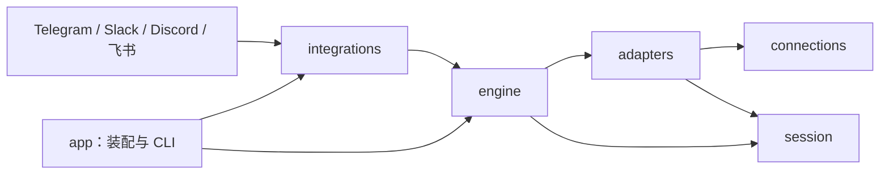

# 当前架构

PocketPilot 是连接消息平台与 AI 编程运行时的会话入口。它统一导航、用户授权、任务提交与结果展示，让同一个原生 session 能从不同设备和消息平台访问。

当前实现包含 Telegram、Slack、Discord、国内飞书；runtime 包含 Codex 原生 app-server 和 PocketPilot 自己管理会话的 Claude Code server 首版。国际 Lark、Pi 与后续问答控件见[后续支持](support.md)。以下描述当前代码，不将规划中的能力算作已支持。

## 概念与职责

| 概念 | 含义 |
| --- | --- |
| Integration | 接收用户消息、提供控制界面和发送结果的消息接入端 |
| Connection | 到执行主机的连接方式，主要为 local proxy 和 SSH proxy |
| Adapter | agent runtime 的协议适配端；Codex app-server 与独立 Claude Code server |
| Workspace | 用户界面里的执行环境或主机 |
| Project | 该执行环境中允许访问的项目目录 |
| Provider | 某个主机上的具体 agent 执行实例，包含身份、连接入口和控制资格 |
| Session | runtime 管理的原生会话；聊天入口通过绑定关联它 |
| Binding | 消息容器与 provider/session 的对应关系，并记录版本和可验证的作用域 |

源码中的持久化 `Workspace` 类型表示项目目录；聊天导航中的 workspace 表示主机。Slack 的 team/workspace 则是消息平台安装范围，与执行环境是不同维度。

## 模块与依赖

| crate | 当前职责 |
| --- | --- |
| `app` | 配置组合、Integration 装配、CLI、日志、catalog 刷新和进程退出 |
| `integrations` | 四个平台的协议、身份校验、原生菜单、渲染、平台 SQL 和收发任务；内部 `network` 复用代理、relay 与受限下载 |
| `engine` | 配置快照、catalog、runtime registry、会话锁、操作账本、文件暂存与共享执行编排 |
| `adapters` | `Adapter` / `AdapterFactory` 契约，以及 Codex 原生协议和 Claude server 的 typed RPC 映射 |
| `connections` | 主机命令与 endpoint；`ssh` 下的 OpenSSH 配置、认证、known_hosts 与 TOTP |
| `agent-server` | 独立 Unix socket 服务、Claude 子进程所有权、会话/历史持久化和输入回执；与聊天桥接进程生命周期分开 |
| `session` | `AgentProvider`、会话/历史/输入模型、展示语义、Markdown 文档和分段规则 |
| `i18n` | 中英文资源、显式 locale、参数插值和类型化错误文案 |

`engine` 不引用消息平台 SDK，`connections` 不解释 agent 协议。平台 SQL 留在各自目录。八个 crate 均不发布到 crates.io；四端默认编译，运行时按配置装配。

`session`、`engine`、`app`、`i18n` 的源码保持平铺；平台实现位于 `integrations/src/telegram`、`slack`、`discord`、`feishu`，OpenSSH 与 Codex 原生代码分别位于 `connections/src/ssh` 和 `adapters/src/codex`。测试放在独立源码文件。

## 公共接口与平台实现

`Integration` 提供平台身份、消息能力、运行和退出入口，由 `app` 注入包含配置、Store 和 RuntimeRegistry 的 `Context`。

`Renderer` 是无 I/O 的渲染接口：输入正文、格式及角色标题，返回有界、可持久化的原生消息段。关联的 Part 类型保留平台表达能力。`AttachmentSource` 负责在已授权输入路径下载附件，并约束 URL、凭据、重定向、大小和超时。

`navigation` 集中执行环境、项目和 session 的选择、归属验证、排序及分页。session picker 返回快照中的实际 offset 和总数；快照过期或游标越界时回到首页，菜单同步丢弃旧翻页记录。

`bindings` 集中清单、缓存状态、可用操作、观察偏好和版本检查。Telegram/Slack 每页八个绑定入口，Discord 最多 25 个；各平台只负责原生控件、身份校验和 scoped SQL。对话入口分别为 Telegram topic、Slack DM thread 和 Discord session channel。

## 连接与会话控制

RuntimeRegistry 按 provider 复用连接，对每个实例串行建连，并用 endpoint 指纹防止同一身份被悄悄指向另一执行环境。每会话 actor 串行处理同一服务进程内的操作；原生 runtime 仍负责与 Desktop、CLI 或其他进程之间的并发规则。

Codex adapter 连接已运行的 app-server，不自动启动 daemon。只有同一执行实例里的会话才能共享真实活跃状态；共用历史目录不足以证明可控制。构建时由所选 Codex CLI 导出 schema，在 Cargo `OUT_DIR` 生成 DTO，不提交生成物。

默认观察路径只读。业务写入包括明确授权的创建、必要的 resume、续轮、带 expected turn 的 steer，以及相关附件上传和空标题补齐。标题补齐限显式用户动作，后台不改原生标题。PocketPilot 不提供停止、取消、审批代答或重启 agent 的入口。

浏览与打开不会隐式 resume。控制资格按实例验证；发送前重新检查操作者、配置快照、项目 cwd、绑定版本和当前轮次。桥接退出只关闭客户端连接，原生任务继续执行。

## 绑定和状态

绑定保存原生 session 身份与聊天容器。Slack/Discord 额外固定 cwd 和 endpoint；Telegram 的执行实例身份由公共 ledger 验证。已有容器不能换绑成另一原生会话。

绑定列表使用现有打开、观察路径生成的元数据缓存，并显示缓存年龄。列表中的状态不是实时读取承诺。已移除项目或 endpoint 变化会使绑定失效，用户仍可明确解除绑定。

“暂停自动观察”停止后续读取和新结果发现，仍允许任务输入与手动查询。已开始的观察及排队投递可按原账本完成；恢复后从原游标继续。观察偏好有独立 revision，不使现有输入控件失效。解绑递增绑定 revision，阻止旧入口继续操作或投递，不停止原生任务。

## 授权、回执与恢复

一次写操作从收到输入、准备、dispatch 到 accepted / rejected / outcome unknown，使用持久操作来源去重。平台资源创建和消息投递另有各自回执。数据库状态更新与对应待投递内容在需要的事务边界内提交。

回执未知时保留不确定状态，不通过重新创建、重新发送或更换消息格式来猜测结果。重启恢复观察，旧输入按所属平台的确认和时效规则处理。菜单和按钮只携带不透明句柄；真正目标、操作者和版本来自持久状态。

这些规则不等于跨平台或跨原生客户端的 exactly-once 保证。各平台 ACK、可重复读取、一次性确认和未知结果的处理仍保留在对应实现中。

## 消息与附件

正文先解析为共同 Markdown 文档，再按平台能力生成原生消息；角色、阶段和错误提示来自 `session::presentation`。不把任意正文直接当作可信 HTML 或平台控制标记，自动输出关闭可触发通知的提及。

| 平台 | 当前主要格式 | 展示边界 |
| --- | --- | --- |
| Telegram | RichMessage | 原生表格、标题、代码、公式和脚注；管理菜单使用独立的 MarkdownV2 转义路径 |
| Slack | Block Kit | rich_text、header 和 table block；不支持的公式等转换为文字 |
| Discord | Components V2 | Text Display、原生控件和图库；表格转成列名与值，正文总预算为 3,600 个 UTF-16 单元 |

预算按最终原生消息计算。长消息保留结构并分段，已冻结的消息段和确认位置持久保存；升级或重启不重新渲染已冻结段。入场展示最近交互，不重放完整历史，不提供历史导出，也不生成 `session.md`。

用户上传文件与文字分开处理。授权后下载到受限临时位置，再通过 runtime 的文件能力写入执行主机；路径属于目标账号，不将远程路径解释为桥接本机路径。当前默认单文件最多 20 MiB、一次输入最多四个文件；平台入口可以有更小限制。

## 状态数据与迁移

根 `pocketpilot.toml` 管主机、凭据、允许目录、代理和运行参数；不读取 `.env`，不支持 include。provider 和项目保存在 SQLite catalog，运行中可以发现和管理。凭据、消息平台身份与部分进程配置更改需要重启；可热更新部分由完整配置快照重新验证。

`[service].data_dir` 保存 PocketPilot 的 catalog、绑定、操作、观察和投递账本。服务锁限制同一状态目录下的 `serve` 单写者。SQLite 使用 WAL；原型期直接维护根 `schema.sql`，初始化幂等，不自动清空旧状态或迁移已有列。

迁移机器时，先停止旧桥接并禁止其自动重启，再一致性复制私有配置、完整 data_dir、SSH 密钥/known_hosts 和必要的认证资料。存在 WAL 时不能只复制 `state.db`；暂停复制期间的 catalog 修改。新机器核对执行账号、endpoint、允许目录和绑定，使用对应系统/架构构建的 binary。只有新部署确认接通后才处理旧副本，不停止原生 agent。

## 独立 retry 工具

`retry` 是用户显式启动的独立 Codex 工具，不随 `serve` 自动运行。它发现允许范围内的会话，仅对当前已加载、空闲、最新轮次确认失败且错误可重试的会话，等待至少 60 秒后提交一次内容为“继续”的新输入。

分类优先使用原生错误代码；缺失或为 `other` 时只匹配原生错误 message，不扫描用户或 agent 正文，永久错误优先阻止自动续轮。并发限制、过载、限流及部分服务端/响应流失败可以重试。认证、额度、上下文、预算、权限、策略和未知错误不自动续轮。原生仍在重试、运行、等待审批/输入、手动中断、关闭或归档时不提交。发送前复查失败轮次、实际 cwd、配置和控制资格；轮次或权限变化取消旧等待，结果未知不重发。

它使用 `data_dir/retry/` 下独立账本与锁，可与 `serve` 同时运行；每个状态目录只运行一份 retry。原生输入不提供针对上一失败轮次的原子比较保证，其他客户端仍可能在最终检查后改变状态。

## 构建与维护

Rust 工具链由仓库配置约束，所有 Cargo 构建、检查、测试和 Clippy 使用 `--release`。`make check` 执行格式、Clippy 和测试，`make package` 保存 binary、构建信息和校验值到忽略的 `dist/`，之后运行 `cargo clean`；`make release` 串行完成整个流程。长期运行引用 `dist/pocketpilot`。

Codex CLI 的默认构建来源是 PATH，`CODEX_SCHEMA_BIN` 仅用于指定构建时导出 schema 的可执行文件，不覆盖运行时连接配置。缺少 CLI 或生成失败会使构建失败，不回退到旧协议快照。协议类型可生成不代表共享执行能力已经验证。

开发标准见 [CONTRIBUTING.md](../CONTRIBUTING.md)，部署与平台操作见[接入方案](integrations.md)。

## 独立 runtime server

`session::server` 是版本化 typed JSONL 契约；它与 Claude 原生 stream-json 隔离，后续 Pi 可以复用安装与代理连接方式。`engine::bootstrap` 仅处理显式配置的 runtime artifact，通过同一 local/SSH 认证链上传、校验 hash、原子安装并启动独立服务；默认目录 `~/.pocketpilot`。后台 catalog 扫描与诊断不会调用 bootstrap。

`agent-server` 在目标账号的私有目录维护 socket、`runtime.db`、输入账本和 uploads。安装锁与服务锁防止并发替换；现有 socket 保留其记录的二进制，不因桥接重启替换运行中的 server。catalog 为 runtime 类型和具体 endpoint 保留身份，控制资格仍需明确登记。

server 只管理自己创建的 UUID session；创建空会话、list/read/history 不调用 Claude。首次显式输入或 resume 才启动长驻 stream-json child，使用 manual 权限模式；后续空闲输入复用同一 child。client/SSH 只拥有 proxy，断线不会关闭 agent stdin。输入发送前持久化 intent，匹配原生 user UUID 回显后保存 accepted receipt；未知结果不重发，server 重启也不自动恢复或继续任务。

只发布主 assistant 的文本块；不混入 thinking、工具输出和子 agent 内容。文件限定在 server 私有上传根并记录 session 归属，图片按 MIME 签名和大小限制转为原生 image block。活跃 steer 尚未开放；结构化 AskUserQuestion 通过原始请求回答，其他权限请求仅体现等待状态，不自动代答。离线 fake CLI 覆盖协议与断线语义，不能据此宣称真实账号/模型全流程已经验证。

## 飞书的消息与传输边界

国内飞书使用 `[feishu]`，身份 scope 为 app/tenant/owner；仅私聊提供目录，一个原生 session 绑定授权群中的 root + thread。导航和绑定管理复用 `Navigator` / `bindings::Manager`，平台 SQL 位于 `feishu` 目录。文字与富文本需 @机器人；独立文件允许 owner 在已绑定话题提交。更多平台事件读取权限不会扩大本地执行授权。

OpenLark 0.21.0 提供认证、token 刷新、protobuf WebSocket 与新版卡片 ACK；REST 通过 core typed Transport，业务只处理具名 DTO。只对 client 做窄 vendor 修补并保留 Apache-2.0 来源：最多 32 分片、单事件 8 MiB、64 个未完成事件、合计 16 MiB 和 15 秒过期；连接日志不包含认证 URL。SDK 的传输日志另被进程级过滤器独立拒绝。入站业务事件再限制为 512 KiB。

HTTP 禁用系统代理、重定向和底层自动重试，WS 经现有有界 relay 使用同一显式代理配置；loopback relay 需要随机访问路径。多个 HTTP SDK 带入不同 rustls provider 时，公共网络入口为进程安装一次默认 provider，保留宿主已有选择，避免影响未配置飞书的其他接入端。

回调在两秒内完成 scope/时效校验及持久化入队，再由 SDK ACK；最多四个后台输入 worker，不在 ACK 路径等待 SSH 或模型。动作 nonce 绑定原消息与聊天、配置 hash、owner 命名空间及五分钟有效期。发送前冻结 Card JSON 2.0，最终编码 payload 保守限制为 28 KB；自动输出与状态更新受绑定/观察偏好约束，未知回执不重发。

群根消息和首次 thread 回复分别记录 provisioning 结果；中途断线标为 unknown，不悄悄补发根消息。已观察历史 cursor 与待投递输出在同一事务提交；首次进入只展示最近交互，后续发增量。队列、活跃绑定及单批卡片数量都有界，历史解绑记录保留用于状态与审计，不增加历史导出文件。

## 结构化问题与显式回答

`session::questions` 定义 `Dialog`、`Question`、`Submission`；`AgentProvider::questions` 只返回当前连接或原生进程拥有的问题。`Mutation::Answer` 复用现有的授权、绑定校验、会话 actor 和持久化操作账本。题目、选项及答案有数量与字节上限；不记录到日志。

Codex RPC actor 直接跟踪 `item/tool/requestUserInput`，不依赖可能丢事件的 broadcast 订阅。回答发回同一连接上的原始 JSON-RPC ID；`serverRequest/resolved`、轮次结束和断线使原回答码失效。其他客户端的问题不会被接管。原生 ID 仅在 adapter 内保存，聊天端使用随机不透明回答码。

Claude 独立 server 持有原生 stdin 与 pending requests。初始化快照与实时请求按 request ID 去重，取消和轮次结束使其失效；代理断开后原生进程仍拥有问题。仅匹配 `can_use_tool/AskUserQuestion` 的请求可构造专用响应，保留原输入与未知扩展字段，补充按完整题目文本索引的答案。多选按原生 SDK 的字符串约定连接；不修改权限规则。协议版本为 2，桥接和独立 server 需成套更新；不会自动重启已运行的旧 server。

`integrations::questions` 统一问题投影、编号、显式 `!answer` 语法及字段校验。问题作为临时展示项进入各平台已有渲染/观察流程，不写入原生历史。普通消息继续走输入/steer；回答在分发前重新确认 runtime pending，先消耗一次性回答码再写传输，结果未知不重发。秘密问题只提示回原生界面，不展示题目/选项或接受聊天答案。各平台的原生选择器、草稿和已取消状态控件仍属后续改进。
