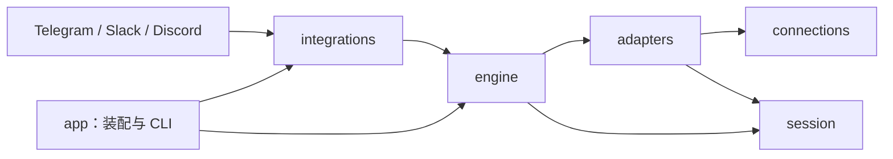

# 当前架构

PocketPilot 是连接消息平台与 AI 编程运行时的会话入口。它统一导航、用户授权、任务提交与结果展示，让同一个原生 session 能从不同设备和消息平台访问。

当前实现包含 Telegram、Slack、Discord，运行时适配为 Codex；Lark、Claude Code 和 Pi 属于[后续支持](support.md)。以下描述当前代码，不将规划中的能力算作已支持。

## 概念与职责

| 概念 | 含义 |
| --- | --- |
| Integration | 接收用户消息、提供控制界面和发送结果的消息接入端 |
| Connection | 到执行主机的连接方式，主要为 local proxy 和 SSH proxy |
| Adapter | agent runtime 的协议适配端；当前为 Codex app-server |
| Workspace | 用户界面里的执行环境或主机 |
| Project | 该执行环境中允许访问的项目目录 |
| Provider | 某个主机上的具体 agent 执行实例，包含身份、连接入口和控制资格 |
| Session | runtime 管理的原生会话；聊天入口通过绑定关联它 |
| Binding | 消息容器与 provider/session 的对应关系，并记录版本和可验证的作用域 |

源码中的持久化 `Workspace` 类型表示项目目录；聊天导航中的 workspace 表示主机。Slack 的 team/workspace 则是消息平台安装范围，与执行环境是不同维度。

## 模块与依赖

| crate | 当前职责 |
| --- | --- |
| `app` | 配置组合、Integration 装配、CLI、日志、catalog 刷新和进程退出 |
| `integrations` | 三个平台的协议、身份校验、原生菜单、渲染、平台 SQL 和收发任务；内部 `network` 复用代理、relay 与受限下载 |
| `engine` | 配置快照、catalog、runtime registry、会话锁、操作账本、文件暂存与共享执行编排 |
| `adapters` | `Adapter` / `AdapterFactory` 契约，以及 `codex` 下的发现、生成 DTO、RPC 和原生操作映射 |
| `connections` | 主机命令与 endpoint；`ssh` 下的 OpenSSH 配置、认证、known_hosts 与 TOTP |
| `session` | `AgentProvider`、会话/历史/输入模型、展示语义、Markdown 文档和分段规则 |
| `i18n` | 中英文资源、显式 locale、参数插值和类型化错误文案 |

`engine` 不引用消息平台 SDK，`connections` 不解释 agent 协议。平台 SQL 留在各自目录。七个 crate 均不发布到 crates.io；三端默认编译，运行时按配置装配。

`session`、`engine`、`app`、`i18n` 的源码保持平铺；平台实现位于 `integrations/src/telegram`、`slack`、`discord`，OpenSSH 与 Codex 原生代码分别位于 `connections/src/ssh` 和 `adapters/src/codex`。测试放在独立源码文件。

## 公共接口与平台实现

`Integration` 提供平台身份、消息能力、运行和退出入口，由 `app` 注入包含配置、Store 和 RuntimeRegistry 的 `Context`。

`Renderer` 是无 I/O 的渲染接口：输入正文、格式及角色标题，返回有界、可持久化的原生消息段。关联的 Part 类型保留平台表达能力。`AttachmentSource` 负责在已授权输入路径下载附件，并约束 URL、凭据、重定向、大小和超时。

`navigation` 集中执行环境、项目和 session 的选择、归属验证、排序及分页。session picker 返回快照中的实际 offset 和总数；快照过期或游标越界时回到首页，菜单同步丢弃旧翻页记录。

`bindings` 集中清单、缓存状态、可用操作、观察偏好和版本检查。Telegram/Slack 每页八个绑定入口，Discord 最多 25 个；各平台只负责原生控件、身份校验和 scoped SQL。对话入口分别为 Telegram topic、Slack DM thread 和 Discord session channel。

## 连接与会话控制

RuntimeRegistry 按 provider 复用连接，对每个实例串行建连，并用 endpoint 指纹防止同一身份被悄悄指向另一执行环境。每会话 actor 串行处理同一服务进程内的操作；原生 runtime 仍负责与 Desktop、CLI 或其他进程之间的并发规则。

Codex adapter 连接已运行的 app-server，不自动启动 daemon。只有同一执行实例里的会话才能共享真实活跃状态；共用历史目录不足以证明可控制。构建时由所选 Codex CLI 导出 schema，在 Cargo `OUT_DIR` 生成 DTO，不提交生成物。

默认观察路径只读。业务写入包括明确授权的创建、必要的 resume、续轮、带 expected turn 的 steer，以及相关附件上传和空标题补齐。标题补齐限显式用户动作，后台不改原生标题。PocketPilot 不提供停止、取消、审批代答或重启 agent 的入口。

浏览与打开不会隐式 resume。控制资格按实例验证；发送前重新检查操作者、配置快照、项目 cwd、绑定版本和当前轮次。桥接退出只关闭客户端连接，原生任务继续执行。

## 绑定和状态

绑定保存原生 session 身份与聊天容器。Slack/Discord 额外固定 cwd 和 endpoint；Telegram 的执行实例身份由公共 ledger 验证。已有容器不能换绑成另一原生会话。

绑定列表使用现有打开、观察路径生成的元数据缓存，并显示缓存年龄。列表中的状态不是实时读取承诺。已移除项目或 endpoint 变化会使绑定失效，用户仍可明确解除绑定。

“暂停自动观察”停止后续读取和新结果发现，仍允许任务输入与手动查询。已开始的观察及排队投递可按原账本完成；恢复后从原游标继续。观察偏好有独立 revision，不使现有输入控件失效。解绑递增绑定 revision，阻止旧入口继续操作或投递，不停止原生任务。

## 授权、回执与恢复

一次写操作从收到输入、准备、dispatch 到 accepted / rejected / outcome unknown，使用持久操作来源去重。平台资源创建和消息投递另有各自回执。数据库状态更新与对应待投递内容在需要的事务边界内提交。

回执未知时保留不确定状态，不通过重新创建、重新发送或更换消息格式来猜测结果。重启恢复观察，旧输入按所属平台的确认和时效规则处理。菜单和按钮只携带不透明句柄；真正目标、操作者和版本来自持久状态。

这些规则不等于跨平台或跨原生客户端的 exactly-once 保证。各平台 ACK、可重复读取、一次性确认和未知结果的处理仍保留在对应实现中。

## 消息与附件

正文先解析为共同 Markdown 文档，再按平台能力生成原生消息；角色、阶段和错误提示来自 `session::presentation`。不把任意正文直接当作可信 HTML 或平台控制标记，自动输出关闭可触发通知的提及。

| 平台 | 当前主要格式 | 展示边界 |
| --- | --- | --- |
| Telegram | RichMessage | 原生表格、标题、代码、公式和脚注；管理菜单使用独立的 MarkdownV2 转义路径 |
| Slack | Block Kit | rich_text、header 和 table block；不支持的公式等转换为文字 |
| Discord | Components V2 | Text Display、原生控件和图库；表格转成列名与值，正文总预算为 3,600 个 UTF-16 单元 |

预算按最终原生消息计算。长消息保留结构并分段，已冻结的消息段和确认位置持久保存；升级或重启不重新渲染已冻结段。入场展示最近交互，不重放完整历史，不提供历史导出，也不生成 `session.md`。

用户上传文件与文字分开处理。授权后下载到受限临时位置，再通过 runtime 的文件能力写入执行主机；路径属于目标账号，不将远程路径解释为桥接本机路径。当前默认单文件最多 20 MiB、一次输入最多四个文件；平台入口可以有更小限制。

## 状态数据与迁移

根 `pocketpilot.toml` 管主机、凭据、允许目录、代理和运行参数；不读取 `.env`，不支持 include。provider 和项目保存在 SQLite catalog，运行中可以发现和管理。凭据、消息平台身份与部分进程配置更改需要重启；可热更新部分由完整配置快照重新验证。

`[service].data_dir` 保存 PocketPilot 的 catalog、绑定、操作、观察和投递账本。服务锁限制同一状态目录下的 `serve` 单写者。SQLite 使用 WAL；原型期直接维护根 `schema.sql`，初始化幂等，不自动清空旧状态或迁移已有列。

迁移机器时，先停止旧桥接并禁止其自动重启，再一致性复制私有配置、完整 data_dir、SSH 密钥/known_hosts 和必要的认证资料。存在 WAL 时不能只复制 `state.db`；暂停复制期间的 catalog 修改。新机器核对执行账号、endpoint、允许目录和绑定，使用对应系统/架构构建的 binary。只有新部署确认接通后才处理旧副本，不停止原生 agent。

## 独立 retry 工具

`retry` 是用户显式启动的独立 Codex 工具，不随 `serve` 自动运行。它发现允许范围内的会话，仅对当前已加载、空闲、最新轮次确认失败且错误可重试的会话，等待至少 60 秒后提交一次内容为“继续”的新输入。

分类优先使用原生错误代码；缺失或为 `other` 时只匹配原生错误 message，不扫描用户或 agent 正文，永久错误优先阻止自动续轮。并发限制、过载、限流及部分服务端/响应流失败可以重试。认证、额度、上下文、预算、权限、策略和未知错误不自动续轮。原生仍在重试、运行、等待审批/输入、手动中断、关闭或归档时不提交。发送前复查失败轮次、实际 cwd、配置和控制资格；轮次或权限变化取消旧等待，结果未知不重发。

它使用 `data_dir/retry/` 下独立账本与锁，可与 `serve` 同时运行；每个状态目录只运行一份 retry。原生输入不提供针对上一失败轮次的原子比较保证，其他客户端仍可能在最终检查后改变状态。

## 构建与维护

Rust 工具链由仓库配置约束，所有 Cargo 构建、检查、测试和 Clippy 使用 `--release`。`make check` 执行格式、Clippy 和测试，`make package` 保存 binary、构建信息和校验值到忽略的 `dist/`，之后运行 `cargo clean`；`make release` 串行完成整个流程。长期运行引用 `dist/pocketpilot`。

Codex CLI 的默认构建来源是 PATH，`CODEX_SCHEMA_BIN` 仅用于指定构建时导出 schema 的可执行文件，不覆盖运行时连接配置。缺少 CLI 或生成失败会使构建失败，不回退到旧协议快照。协议类型可生成不代表共享执行能力已经验证。

开发标准见 [CONTRIBUTING.md](../CONTRIBUTING.md)，部署与平台操作见[接入方案](integrations.md)。
