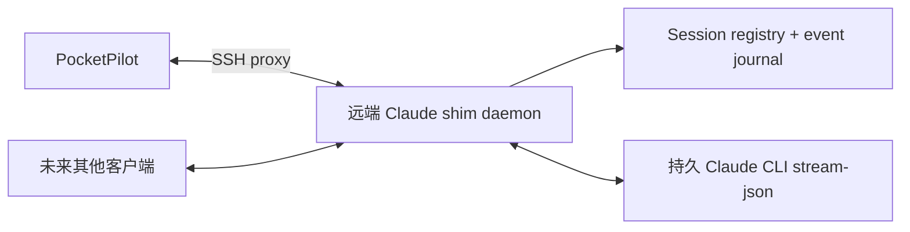

# Lark 与 Claude 兼容 shim 规划

两者均为后续规划。Telegram + 原生 Codex 仍是首版重点；设计保持 Rust 核心与平台/provider 的独立边界。

## 1. Lark 可行性结论

**能承载所需交互**：官方 thread 介绍明确支持 thread_id、线程回复、thread 模式群、按 thread 分页历史；卡片和消息能力能展示会话信息与操作入口。它适合作为 Telegram 之后的另一平台，但不把它当成 Telegram Topics 的完全同构替换。

建议采用用户自建企业应用 + bot：一个 workspace 一个配置允许的群；一个 session 一条根消息和 thread。使用普通群的 `group_message_type=thread` 模式，或在普通群通过 reply_in_thread 建立 thread。创建/切换群模式是管理员明确安装操作，不由 PocketPilot 为了绑定会话自动修改整个群。

```text
PocketPilot · PP 工作区群
  根卡片：🟢 调查测试失败 · a13f5b
    thread：历史集合 / 用户输入 / 合并后的 agent 回答
  根卡片：⚪ 发布准备 · c051a2
    thread：最近交互 / 用户输入 / 回答
```

官方建议区分旧 topic group（chat_mode=topic）与普通群的 thread message 模式；首选后者，避免依赖旧群类型创建限制。普通群也可用根卡片目录管理多个 workspace，若实际组织需求更适合一个总群，地址模型无需改变。

## 2. 平台映射

| PocketPilot 能力 | Lark 实现方向 | 需要验收的边界 |
| --- | --- | --- |
| 选择 host/workspace/session | 应用 bot 的菜单、根卡片按钮/消息指令 | tenant、user、chat 允许列表；按钮 action nonce |
| 独立 session 容器 | 根消息 + thread_id（omt_ 开头） | 有效根消息、群类型与成员可见性 |
| 会话短名/运行状态 | 更新根卡片标题、状态与最近观察时间 | 不假设 thread 有 Telegram 式独立 rename API |
| 普通文本继续/steer | 接收消息事件，用 thread/root 路由 | 群非 @ 消息所需权限、审批和发布；不假设 bot 默认收到全部群消息 |
| 合并输出/完整历史 | 富文本/卡片或一条文件消息 | 每种消息的最新大小限制、上传权限、单条附件上限 |
| 本机运行无需公网入口 | outbound WebSocket 长连接事件接收 | 应用类型、region 和当前 SDK 的事件/回调支持 |
| 交互反馈 | 卡片 callback 快速 ACK，再异步处理 | 新旧 callback 协议、超时和卡片可更新期限 |

PlatformAddress 增加 `Lark { region, tenant_id, chat_id, thread_id, root_message_id }`。不能只用 thread_id 当全局地址，不能混用 Lark 国际版和飞书国内版的域名、应用凭据与 token。配置显式选择 region，分别验收。

官方 thread 文档提供按 thread 获取消息的 API，可帮助平台投递核对；但不能由此宣称 Lark 端提供无限期幂等或 exactly-once。SDK reply model 中有 uuid 字段，真正重试前需要查明对应 API 的去重窗口/作用域；字段存在本身不是保证。也不能用 merge_forward 把尚未在 Lark 发送过的 provider 文本直接转成转发合集。

## 3. 长连接、卡片和 Rust 实现

实际读取的官方 Python SDK 具备 WebSocket client、心跳/重连、分片组包和事件分发，证明可不为消息事件部署公网 webhook。WS 不只是 JSON 文本帧，不能直接把 Telegram poller 替换成一个简单 WebSocket read loop。

Lark 能力依据官方文档和 SDK 源码交叉核对。官方 samples/ws/sample.py 确实注册新 `card.action.trigger` 并交给 ws.Client，说明新版卡片长连接已有参考实现；仍须按实际 SDK/地区/应用配置验收，不能把旧协议自动当成同一能力。目标组合未通过时先保留文本命令交互、卡片只读；需要 webhook 则显式部署，不假装本机已有公网入口。

保持 Rust 主进程。生态候选 open-lark 查询时为 0.14.0、约 3.24 万下载，明显少于 Telegram 的 teloxide，不能仅因名字合适就认定成熟。Lark 阶段先审查其 WS/卡片/幂等/脱敏与维护情况：通过则封装成 adapter；不通过则用 reqwest/serde/prost/tokio-tungstenite 适配必要的公开 REST/WS 子集，复用现成 HTTP、TLS、protobuf、重试库，不自写通用网络协议。

不默认引入 Python sidecar；如纯 Rust 协议投入不合理，官方 SDK sidecar 只作为明确的部署取舍，并保持窄 IPC 边界。它改变部署技术栈，需要届时再决定，当前不以此完成“Rust Lark 已支持”的承诺。

卡片 callback 要在官方要求的期限内快速持久化/确认，再进行慢 SSH 工作。长驻会话的旧卡片可能超过更新/交互有效期，应按实际 API 期限刷新目录卡片，保存新 root/message 映射与旧 nonce 失效；不能指望同一张卡永久可操作。具体期限和配额在 Lark 阶段按实际 API 查证后写入 profile。

## 4. Lark 阶段验收

先在自建应用测试租户验证：群内非 @ 文本能否接收、thread_id/root 路由、状态卡更新、文件历史集合、卡片回调、权限撤销、token 轮换、断网恢复、重复事件和限速。消息合并复用 [消息批次设计](../design/history-and-delivery.md)，不改变 Codex 控制白名单。

可行性是平台能力判断，尚未创建 Lark 应用、读取租户消息、运行 Rust adapter 或进行真实回调验收。

## 5. Claude shim 的定位

**可以规划一个兼容 Codex app-server 常用 wire 子集的 Rust shim**，远端独立运行并管理它创建/接管授权范围内的 Claude CLI 会话。它让 PocketPilot 复用 JSON-RPC transport 与常见 DTO，而不是让 Claude 变成 Codex 引擎。

保留 AgentProvider 抽象，不把所有 provider 强制伪装为 Codex：shim 实例在 config 中标为 `claude_shim`，有自己的 capabilities 和协议 profile。其 initialize 返回明确身份，能力来自显式配置/扩展握手；不伪报官方 Codex user agent。未知/不支持方法返回明确错误。

兼容目标分三层：

1. **PocketPilot 使用的协议子集**：可作为第一目标。
2. **通用 Codex 协议客户端**：需要更大范围的方法、事件和错误兼容测试。
3. **原生 Codex Desktop 直接作为 Claude GUI**：不保证。Desktop 可能依赖额外方法、认证、项目/工具/模型语义和私有生命周期，不能由 JSON-RPC 名称相同推导 drop-in 兼容。

## 6. 独立守护架构



SSH 首次进入可以执行幂等 `ensure-running`：只在 shim 从未运行且没有已知活跃任务时建立独立 daemon，常驻服务由受配置允许的 service manager 管理；已有服务只连接，不升级/重启。代理进程退出不关闭 daemon，也不能给 Claude stdin 发 EOF。

shim 进程与 SSH/PocketPilot 分离，持有 CLI stdin/stdout、session lease 和输出 journal。一个 Claude session 只有一个执行 owner，多客户端通过 shim 复用这个 owner。CLI 变慢或客户端背压时，daemon 持续读取并落盘，不能让断线客户端的管道堵死执行器。

持久记录 shim thread ID → Claude session ID、cwd、policy、active turn、ownership、journal cursor。使用 sessionId 精确恢复，不用 `--continue` 的“最近会话”语义；不同 workspace 不会争用同一个 latest session。

本地重启或 SSH 重连不产生新 CLI/新 turn。shim 自身故障可能影响其拥有的 CLI：不能声称兼容层消除了这个事实。后续需考虑 executor worker 与 RPC gateway 分离，让 gateway 重启不回收 worker；daemon/executor 的 stop/restart 不对 PocketPilot 暴露。机器故障仍属于外部执行环境失败，忠实标示而非偷偷重跑。

## 7. 协议映射与能力差异

| Codex wire 子集 | shim 规划 | 限制 |
| --- | --- | --- |
| initialize / initialized | shim 身份与能力/profile 握手 | 不伪造官方完整服务 |
| thread/list/read、历史分页 | shim registry + 自己的 journal | 先支持 shim 管理的 session；不声称全机器 CLI 自动发现 |
| thread/start | 登记新会话，按受测 CLI 模式启动执行 owner | daemon 预先独立运行，用户明确创建触发 |
| thread/resume | rejoin shim owner；历史续轮时精确 --resume | 不自动抢占外部活跃 CLI，不 fork |
| turn/start | 向持久 CLI 输入后续任务 | queued/accepted/processed 分清楚 |
| turn/steer | 仅在真正非中断追加语义验证后开启 | 普通队列输入不冒充 steer；不支持就返回 Unsupported |
| thread/status/changed、文本事件 | Claude 事件 → normalized 状态/可见文本 | system init/result/assistant/tool 状态映射需验证 |
| interrupt/kill/rollback 等 | 不实现、不向 CLI 透传 | 遵守原来的四类业务动作限制 |

官方 Claude CLI 支持 `-p --input-format stream-json --output-format stream-json`、session ID resume、`--replay-user-messages`；Agent SDK 文档描述长驻 streaming input 和顺序排队消息。这些提供进程化接入基础，但没有证明 queued input 等于 `expectedTurnId` 保护下的 Codex steer。

shim 可对客户端 expectedTurnId 做原子检查，但还需证明 Claude 真正把输入合入**当前**轮而非排到下一轮；本地检查通过不能替代执行引擎的语义。绝不使用 SDK interrupt / SIGINT / 关闭 stdin 来模拟 steer。无法满足时，后期 Claude 只提供“作为下一轮排队”，且 UI 明确它是不同能力。

官方 headless 文档还指出：SIGTERM 会结束 Claude 和运行中 Bash 子进程；SDK 关闭会结束输入，待授权请求可能随之取消。因此 CLI 不能是 PocketPilot 的直接生命周期子进程。Claude 的内建 budget/idle/background 策略也可能结束任务，必须在新会话 profile 中明确，而不能运行中偷偷改策略。

## 8. 已有 Claude 会话与后续研究门禁

第一版 shim 只管理自己创建的会话和用户明确导入的空闲历史。官方文档提示 transcript 格式是内部、可能改变；不能通过直接写 JSONL 实现控制。历史读取优先官方可用接口或 shim 自己的 journal；不要为了获取最后输出发一条“请总结”新任务。

某些新版 Claude CLI 文档提供 background session 的 attach/resume 能力，可作为后期接入既有活跃 session 的研究入口，但当前不据此保证通用结构化多客户端控制。普通交互 CLI 进程若没有受支持的附着接口，shim 无法凭一个 transcript 路径获得其 stdin 或真实运行状态。

后续门禁：CLI 版本和 wire fixtures、空闲续轮、stream input 收到/处理区别、final 识别、权限请求宿主、外部 session ownership、断线不 EOF、executor 存活、真正 steer、重复输入不确定性和 Codex Desktop 兼容层级。缺失任一关键能力都要在 capabilities 降级，不以“兼容 shim”掩盖。

## 9. 已找到的库与实现

补充调研找到了直接相关的实现，因此不需要从零发明所有协议转换。以下是实际读取 README、包元数据及部分生命周期源码后的判断；stars/downloads 仅为 2026-10-15 的生态快照，不是质量保证。

| 候选 | 可复用内容 | 成熟度与边界 |
| --- | --- | --- |
| [mmonad/codex-acp-gateway](https://github.com/mmonad/codex-acp-gateway) | Rust，**Codex app-server ↔ ACP 转换**，history/ID mapping/wire DTO、stdio/WS | Apache-2.0，约 5 stars；所读版本 2026-03，vendored Codex types 和 ACP 0.9 已落后当前协议，需重新核对 |
| [agentclientprotocol/claude-agent-acp](https://github.com/agentclientprotocol/claude-agent-acp) | Claude 官方 Agent SDK 的 ACP adapter，工具/权限/会话/文本映射 | Apache-2.0，约 2648 stars；原 Zed 链接已迁移。TypeScript/Node，不是 Rust，也不是 Anthropic 官方 Rust SDK |
| [agentclientprotocol/rust-sdk](https://github.com/agentclientprotocol/rust-sdk) / agent-client-protocol | ACP 官方 Rust 类型、连接、agent/client/proxy | Apache-2.0；crate 3.3.0、约 525 万下载。**ACP 不等于 Codex app-server 协议**，仍需转换层 |
| [tyrchen/claude-agent-sdk-rs](https://github.com/tyrchen/claude-agent-sdk-rs) | Rust 包装 Claude CLI、双向流、control、session | MIT；crate 0.6.4、约 2.92 万下载、78 stars。社区实现；README 自称生产可用不能替代我们验收 |
| [Wally869/claude_agent_sdk_rust](https://github.com/Wally869/claude_agent_sdk_rust) | 另一个 Rust Claude CLI SDK，双向会话/权限等 | crate claude-agent-sdk-rust 1.0.0、约 517 下载、26 stars；许可证信息和维护需独立核实，不与上一 crate 混淆 |

### 9.1 最直接的 gateway 为何不能原样采用

固定版本 `81db00d32207c3333cd05ab6463099ae21fc0d46` 的代码中：

- src/acp_proxy.rs 为每个 WebSocket 连接启动 agent；连接断开后 drop stdin，并调用 child.kill()/wait()。
- src/lib.rs 在 Codex client disconnected 时退出 gateway event loop；还存在 cancel、rollback、fork 等协议路径。
- README 的“任何 Codex client 使用任何 ACP agent”是作者目标，不是本项目已证明的最新 Desktop 兼容结论。

所以它是直接的协议映射参考/可审计 fork 候选，不是满足 PocketPilot 要求的即插即用 daemon。需要把执行 owner 从连接生命周期移到 session registry、限制四类业务动作、处理多客户端与持久 journal，并升级协议基线。不能只在外面套一个 service manager 就忽略内部 disconnect→kill 路径。

### 9.2 SDK 同样需要生命周期隔离

claude-agent-sdk-rs 所读版本的 SubprocessTransport Drop 调用 process.start_kill()，end_input 会关闭 stdin。SDK 不是天然的“断线保持会话”工具：它只能被独立 executor worker 持有，不随 PocketPilot/RPC handler/SSH connection drop。关闭、超时、重建 client 和 worker supervisor 的全部路径都要验收。

本项目不暴露库中 interrupt、permission mode 修改、fork、kill 等能力；业务接口只允许安全子集。SDK 缺乏可控制的进程所有权时，不采用其高层 Client 生命周期，改复用 DTO/stream parser 或受控 CLI transport。

### 9.3 推荐后期选型顺序

1. 优先验证纯 Rust 路线：独立 Rust executor + 经审计的 Claude CLI SDK/stream transport；shim 的 Codex 子集参考 gateway 实现，不引入整个 Codex 执行引擎。
2. 若 CLI 协议维护成本过高，比较 Rust gateway + Claude ACP adapter：成熟 ACP Rust SDK 与 Claude adapter 可减少语义适配工作，但引入 Node/TypeScript，且仍需独立 executor，不能直接使用 connection-per-agent proxy。
3. 对 gateway 只复用/按许可证 fork 必要模块，重新跑最新 Codex profile 和生命周期测试。模型 API 的 OpenAI-compatible/Anthropic-compatible 代理不是 session app-server shim，不能混为一谈。

该选择只影响后续 Claude 阶段，不为当前 Telegram + Codex MVP 引入 ACP/Node 依赖。本次没有安装、编译、运行任何候选，未验证真实 Claude steer 或已有活跃 CLI 接管。
