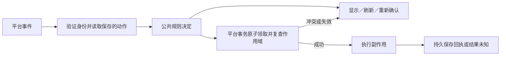

# 三端交互状态转换收束规划

状态：规划，基于 `55d8243` 的实现核对。本次只整理方案，不修改运行代码、数据库或独立 retry 工具。

## 目标与已有基础

统一的是“在已验证的上下文中，一个事件应该导致什么下一步”，包括刷新页面、重新确认、原子领取动作、准备原生操作或登记投递结果。平台继续验证自己的身份、解析事件并操作原生控件。

已有 [Navigator](../../crates/integrations/src/navigation.rs) 负责目录选择、排序分页、session 查询和父级定位；它不是菜单生命周期状态机。[OperationState](../../crates/session/src/operation.rs) 和 [execute_dispatched](../../crates/engine/src/operations.rs) 已统一部分原生写入及结果未知处理，后续扩展这些模块，不另建一套操作账本。

## 一、实际相同的规则

| 规则族 | 共同转换／决定 | 平台负责的证据与执行 |
| --- | --- | --- |
| 菜单动作 | 有效且可复用 → 解析下一步；过期／失效 → 刷新入口或重新确认；一次性确认 → 原子消费成功后继续 | 原生事件身份、菜单消息、nonce、选择下标、配对／owner 与平台 ACK |
| 平台资源创建 | 未创建 → 原子领取 → 创建中 → 已创建／拒绝／结果未知；已创建返回原绑定；未知创建不自动再发 | topic、channel、根卡片的资源键、原生 ID 和平台资源账本 |
| 输入确认 | 新鲜且绑定有效 → 准备；重启恢复／过期 → 待确认；新确认仍须复核原绑定；绑定变化 → 拒绝 | 原消息／附件引用、恢复标记、配置与绑定 revision 的事务复查 |
| 输入到原生动作 | Idle → Start；Active 且 turn 已确定 → Steer；NotLoaded → 获授权 Resume 后重新读取；冲突／状态不明 → 不写入 | 会话锁、实际状态读取、上传文件、持久授权及 RPC |
| 操作准备与回执 | Received → Prepared → Dispatching → Accepted／Rejected／OutcomeUnknown；重复 Accepted 读取原回执；未知请求不重发 | 幂等键、原子 dispatch、原生接口、回执保存 |
| 新消息投递 | Pending → Dispatching；确认回执 → 下一段或 Delivered；明确未接受且限流 → 等待；回执未知／进程恢复 → OutcomeUnknown | 原生消息段、具体限速、HTTP 错误分类、平台 SQL 与回执 |

“打开会话”可能创建 Telegram topic、Discord channel 或 Slack 根卡片。必须区分按钮复用与实际资源创建：重复打开已有绑定可以复用；首次创建资源必须有原子领取及持久回执，未知结果不能靠再次点击触发第二次创建。

## 二、不能直接视为等价的地方

| 当前差异 | 处理方式 |
| --- | --- |
| Telegram 保存菜单发布回执，并对旧菜单、数字回复及恢复确认分别处理；Slack／Discord 的动作记录没有相同的发布字段 | 平台提供自身真实证据；不为适配公共结构伪造 published 或 click time，不先统一菜单表 |
| Slack 普通只读动作 TTL 为 30 天，其他动作为 300 秒；Discord UI nonce 为 24 小时；Telegram 写确认另检查发布时间与进程恢复 | TTL、可复用性、恢复策略用明确策略类型表达。首批保留现有时间配置，不静默改成同一个常量 |
| Telegram 的菜单选择存在整页消费，Slack 普通只读动作可复用，Discord 只对 Open UI 动作消费 | 把交互句柄复用与实际副作用领取分开。Slack 的 Open 句柄可复用，但已有 provisions 账本保护资源创建；不能因为它可能创建卡片就直接改成一次性按钮。先统一实际副作用至多一次的约束，句柄消费策略保留并分别验收 |
| Telegram 在缺少 active turn／发生 steer 冲突时提供草稿确认，另两端主要返回错误 | 首批抽取统一决定，平台保持原提示；三端统一确认体验属于后续明确的行为变更 |
| Telegram 的 NotLoaded 分支 Resume 后直接准备 Start；Slack／Discord 重新读取状态 | 目标统一为 Resume 最多一次，随后重新读取并重新规划。不能用 Resume 前的状态直接推断 Start；该修改按行为修正验收 |
| Discord 当前没有与 Telegram／Slack 等价的持久离线命令 Inbox | 不强行统一 Inbox 全状态机，也不借重构自动加入离线写入重放 |
| Telegram、Slack、Discord 的队列预算、元数据更新和终态清理不同 | 公共层统一结果决定，平台保留限速、payload 清理、图标及容器生命周期 |

## 三、共同接口的形状

公共策略优先使用普通 struct、enum 和无 I/O 函数。示意接口不代表已经导出的 Rust API：

```rust
fn decide_interaction(
    snapshot: &InteractionSnapshot,
    event: &InteractionEvent,
    policy: ActionPolicy,
    now: Timestamp,
) -> InteractionDecision;
```

`InteractionSnapshot` 来自服务端保存的动作及当前验证结果；不能从 callback payload 直接构造可信的项目、会话或授权。事件只引用保存的选择，不携带任意可执行操作。

`InteractionDecision` 表达 `Show`、`Refresh`、`Confirm`、`ClaimOnce`、`Ignore` 或 `Reject`。`ClaimOnce` 是领取请求，不是已经授权成功的执行许可。平台用条件 SQL 原子领取并重新核对作用域，只有成功后才进入副作用执行。

动作分类区分纯浏览、平台资源创建、agent 写入和平台删除；交互复用与副作用领取是两个维度：

| 动作 | 交互句柄 | 实际执行约束 |
| --- | --- | --- |
| 列表、返回、刷新 | 通常 Reusable，保留平台旧菜单规则 | 不创建资源或 agent 任务 |
| 打开已有会话 | 可重复打开；初期保留三端现有句柄策略 | 已有资源返回原绑定；缺少资源时按资源键原子领取；未知创建停止 |
| 创建／续轮／追加／上传 | 新鲜用户动作；一次性确认按策略消费 | 持久操作键保证单次 dispatch，Accepted 读取原回执 |
| 删除平台容器 | 一次性确认 | 对明确目标及 revision 原子领取，结果未知不续删 |

避免用一个含混的 `writes()` 同时代表是否写 agent、是否创建平台资源以及按钮能否复用。公共策略发出领取意图；平台资源账本和 agent 操作账本分别保证原子执行。

消息创建时间、菜单发布时间、事件接收时间和进程恢复标记分别表达。尤其 Telegram callback 的消息时间不是点击时间，不能将三端统一为 `now - event.timestamp < 300`。



查询、确认和领取之间有 await 时，旧的验证结果不能代替 dispatch 前复查。公共纯函数不产生可脱离事务使用的万能授权 token，也不在 SQLite 事务内等待网络。

## 四、按批次实施

### 批次 1：动作分类与共同判定

- 新增平铺的 `integrations/src/interaction.rs` 与独立测试文件。
- 核对三个平台全部动作，记录副作用、复用、时效、恢复和确认要求；统一表达有效、过期、撤销、绑定变化、已消费等判定。
- 先在平台读取现有数据后调用共同策略，保留现有原子 SQL、持久动作编码、ACK 和错误展示。
- 验收：另一用户／容器／绑定不可借用动作；重复浏览不创建平台资源或原生任务；一次性动作并发点击最多一个成功；Telegram callback 时间规则正确。

### 批次 2：菜单状态与 Telegram 导航封装

- 新增 `integrations/src/navigation_state.rs`，已有 `navigation.rs` 保持查询职责。
- 共同表达工作环境、项目、session 页面及选择、返回、刷新、下一页事件；原生菜单只将这些决定映射成按钮、下拉框或命令。
- 在 Telegram 内形成真正拥有菜单生命周期的 `Navigation` 模块，负责保存页面、发布回执、读取事件、策略决定和动作领取。`Service` 调用小接口，不再跨多个文件直接管理全部菜单字段。
- Telegram 按钮和数字输入归一成同一选择事件；topic 删除／批量清理仍为平台专属动作。
- 对 Open 共用“读取资源状态 → 返回已有绑定／原子领取创建／停止未知创建”的决定，复用各端已有 provision 记录；不把可重复打开强制改成一次性 UX。
- 首批不统一原生页面布局，也不改变 session 游标编码或凭空增加三端“上一页”能力；游标仍由已有 picker 验证作用域与快照。
- 验收：旧菜单不覆盖新菜单；未确认发布的菜单不会执行副作用；浏览与新建共用目录规则；菜单被删除后的恢复语义通过既有 fixtures。

### 批次 3：输入规划与操作准备

- 在平铺的 `session/src/input.rs` 中集中纯输入规划：当前状态、明确用户意图与已知 turn → Start、Steer、Resume 后复查、重新确认或拒绝。
- 扩展既有 `engine::operations` 的准备接口，收拢重复的 reserve、读取已有回执、Received→Prepared 规则；继续复用现有 execute_dispatched。
- 平台保留身份验证、绑定事务和原子 dispatch。三端相同的操作前置流程收束后，再按动作类型减少各 `mutate` 中的重复代码。
- Accepted 必须返回原回执；Prepared／Dispatching／OutcomeUnknown 不因重复事件自动变回 Received。resume、upload、input 等已有操作子键保持稳定。
- 统一 Resume 后复查时，最多 Resume 一次；仍未加载或已无法确定状态就停止写入。Steer 冲突不能自动转 Start。
- 验收：只读实例零写入；Resume 与重新读取之间出现外部新 turn 时按新状态处理；绑定 revision 变化拒绝；重复输入不产生第二个原生请求；附件和原绑定一起重新确认。

### 批次 4：新消息投递与回执决定

- 新增 `integrations/src/delivery_state.rs`，集中分段游标、结果分类及恢复决定。
- 平台将 HTTP／SDK 结果归一为明确成功、明确未接受的限流、明确拒绝或结果未知；公共层决定确认下一段、等待或终止。
- 已确认段不可重发，冻结消息段不可在恢复时重新渲染；崩溃恢复的 dispatching 进入 outcome_unknown。
- 原生消息段、限流预算、发送前平台授权复查、SQL 更新与敏感内容清理仍在各端。先统一新发消息；已知消息 ID 的幂等更新、资源创建及删除分别核对语义，不共用不加区分的重试策略。
- 验收：远端接受但回执丢失时不补发；确认第 N 段后重启不重播前缀；429 仅按确实未接受请求的证据重新调度；owner 查询暂不可用不被误判为永久撤销。

### 批次 5：封装收尾与旧实现删除

- 依据前三／四批形成的接口收拢 Telegram 的 Navigation、Delivery 及其 repository 所有权，减少 Service／Store 的跨文件直接访问。
- 删除已被共同接口替换的重复判定和薄转发；不保留源码兼容 facade，不新增一个继承全部平台字段的大 Service。
- 测试通过共同接口验证规则，平台 fixtures 验证原生协议、作用域和事务。共同规则不再三份重复单测；保留能发现平台映射错误的集成用例。
- 每批检查实际删掉了什么：若只是增加适配和委托层、原分支仍完整存在，应继续合并或撤回该抽象。

建议先实施批次 1–2，完成一轮可审阅的交互收束；批次 3、4 分开推进，各自有独立的行为验收。

## 五、目录与验证约束

共同菜单／投递策略位于 integrations 根目录；AgentProvider 输入语义位于 session；运行时查询、操作账本和执行位于 engine。三端 SDK 类型、平台 SQL、身份验证、配对、ACK 和容器资源仍在各自平台目录。session/src 保持平铺。

首批使用现有表与持久 action 格式映射共同状态，不为重构新建通用菜单数据库。后续确需改字段或使旧动作失效时，单独说明对本地部署数据的影响，按仓库原型 schema 约定处理，不引入 migration runner。

不新增 actor／状态机／任务队列依赖；现有 Tokio、SQLx 与平台 SDK 足够支撑这些模块。独立 retry 功能不在本规划范围内。库复用依据见 [核验文档](../research/integration-library-reuse.md)。

实现批次统一运行 `make check`，必要的 protocol fixtures 验证后再 `make package`，保留 dist/ 可执行文件并顺序 cargo clean。规划文档自身只检查链接、格式与内容一致性。

## 当前代码证据

- Telegram 菜单与输入：[navigation](../../crates/integrations/src/telegram/navigation.rs)、[navigation_store](../../crates/integrations/src/telegram/navigation_store.rs)、[input](../../crates/integrations/src/telegram/input.rs)。
- Slack 动作消费与确认：[storage](../../crates/integrations/src/slack/storage.rs)、[commands](../../crates/integrations/src/slack/commands.rs)、[input](../../crates/integrations/src/slack/input.rs)。
- Discord 一次性 Open 与输入：[storage](../../crates/integrations/src/discord/storage.rs)、[input](../../crates/integrations/src/discord/input.rs)、[commands](../../crates/integrations/src/discord/commands.rs)。
- 操作与投递：[session operation](../../crates/session/src/operation.rs)、[engine operations](../../crates/engine/src/operations.rs)、[Telegram outbox](../../crates/integrations/src/telegram/outbox.rs)、[Discord delivery](../../crates/integrations/src/discord/delivery.rs)。
