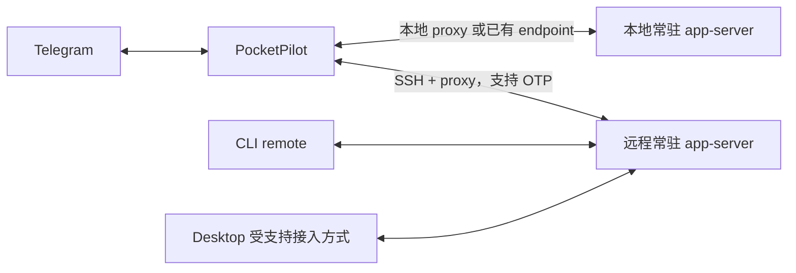

# 探索结论与可行性边界

日期：2026-10-15（初始探索快照；当前真实验收见 [实现记录](implementation-checks.md)）。本文把「官方协议支持」「本机静态验证」「源码行为」「尚待实际验证」分开。研究范围是 Rust 实现的 Telegram + Codex MVP。

修订部署前提：本机已有管理本地和 SSH 任务的 Codex 体系，PocketPilot 默认本机启动；它聚合允许实例，不假定一个本地 RPC endpoint 代理所有远程任务。SSH 的 desktop/CLI/PocketPilot 应连相同远端 daemon。详见 [部署与生命周期契约](../design/connections-and-config.md)。

## 1. 结论

方案可以基于 Codex app server 实现，但必须先证明 PocketPilot 与桌面/CLI 接入的是**同一个运行实例**。不能以「能列出同样的 thread ID」代替这项证明。

推荐路线：

1. 手工登记 host 和工作区；自动发现只给建议。
2. 通过现有 app-server endpoint 或 `codex app-server proxy` 加入已有服务。
3. 用只读 API 浏览/观察会话；只有用户明确续轮时才能把历史 resume 作为准备动作。
4. 运行中的 thread 使用 `turn/steer`；空闲 thread 使用 `turn/start`。
5. 持久化 Telegram 绑定和消息投递记录；断线后核对状态与历史，绝不重放结果未知的写请求。
6. 在支持版本、三端共享和断线语义验证通过前，降级为历史只读浏览。

这意味着不采用「每个 topic 启动一个 `codex exec`」「每次消息另起 app-server」「读 JSONL 后复制上下文新建会话」作为 MVP 实现。

## 2. 需求与能力映射

| 用户需求 | 已找到的能力 | 结论与限制 |
| --- | --- | --- |
| 列出所有工作区 | thread 的 `cwd`、可选 `projectId`；桌面另有项目管理能力 | 查阅的公开稳定 schema 中没有通用 `workspace/list` 或 `project/list`；手动添加是 MVP 正路 |
| 列工作区会话 | `thread/list`，支持 cwd、归档、来源与分页 | cwd 是精确匹配，不会自动覆盖子目录、符号链接或 worktree |
| 读取会话 | `thread/read`；新版本 `thread/turns/list`、`thread/items/list` | 只读读取不等于订阅；旧版与新版历史接口不同 |
| 加入活跃会话 | `thread/resume` 对同进程 loaded thread 走 rejoin 路径 | 不传 model/cwd/config 等覆盖；这仍改变订阅集合，不能描述成完全无状态操作 |
| 查看运行状态 | `ThreadStatus` 与 `thread/status/changed` | 状态属于所连接的服务；另一个服务返回 notLoaded 不能证明原服务空闲 |
| 中途继续输入 | `turn/steer`，强制 `expectedTurnId` | 需真实 active turn ID；review/compact 等 turn 可能不可 steer |
| 三端可见 | 同一 app-server 多连接与 CLI remote 模式 | 协议机制存在；具体 desktop 版本能否接入/展示需集成验证 |
| SSH 连接 | `ssh … codex app-server proxy`；或 SSH 转发到已有 WebSocket | 必须连接独立存活的服务，SSH 仅承载连接 |
| 不停止会话 | 不发 interrupt/关闭服务等操作 | 还需验证最后连接消失、待审批请求、远程进程退出等间接路径 |

## 3. 版本与入口验证

PATH 中的 CLI 与 Desktop 内置服务可能来自不同版本，schema、历史读取模式和共享入口也可能不同。部署前分别核对版本、帮助、协议类型及公开 listener；不要从某台开发机的进程参数推断所有安装均相同。

静态检查只读取版本、帮助、schema 和进程/socket 元数据，不执行 resume、创建、steer 或服务重启。实际账号、地址、目录和运行记录保存在私有部署资料中。

从两份二进制分别生成**未加 `--experimental`** 的 JSON Schema：

| 能力 | CLI 0.149.1 | Desktop 0.162 alpha |
| --- | --- | --- |
| `thread/list/read/resume` | 有 | 有 |
| `turn/start/steer` + expectedTurnId | 有 | 有 |
| `clientUserMessageId` | start/steer 有 | start/steer 有 |
| `thread/resume.excludeTurns` | 未暴露 | 有 |
| `thread/turns/list`、`thread/items/list` | 未暴露 | 有 |
| 通用 `project/list`、`workspace/list` | 未发现 | 未发现 |

因此示例中的新字段不能无条件发送给所有版本。官网页面也不能当成某个本机二进制的契约。实现采用 [动态 schema 生成说明](../design/protocol-generation.md)，不在 docs 中保存 JSON 快照。

MVP 只支持实施时最新、通过验收的 Codex profile，不做旧版 legacy history 兼容。用户允许必要的 CLI 升级；升级和服务切换是维护步骤，PocketPilot 不在自身生命周期中自动重启活跃 daemon。

PocketPilot 的 Workspace ID 与桌面的 projectId 独立。手动登记 cwd 不等于在桌面创建或分配项目；如果目标桌面需要额外的私有项目登记才能展示新 thread，必须在 P0 查明受支持的流程。不能直接改桌面状态文件来补齐归属，也不能把 PocketPilot 分组成功误报为桌面工作区归属成功。

## 4. 接入 Codex app server

### 4.1 协议

官方协议是双向 JSON-RPC 风格：wire 上省略 `jsonrpc: "2.0"`。必须区分客户端请求、响应、通知和**服务端主动请求**，不能只实现单向 request/response。

每次新连接都执行：

```json
{"id":1,"method":"initialize","params":{"clientInfo":{"name":"pocketpilot","version":"0.1.0"}}}
{"method":"initialized"}
```

第二条需等待 initialize 成功后发送；这只是协议示意，非可以连续无等待发送的完整程序。experimentalApi 默认不开启。必要时按受测版本 profile 显式启用，不能收到错误后全量打开实验能力。

传输：

| 传输 | 说明 | 采用方式 |
| --- | --- | --- |
| stdio | 原生 stdio app-server 可用 JSONL，但现有 stdio 进程不能被第二个客户端直接附加 | PocketPilot 不启动 fresh app-server；官方 proxy 管道实际传递 WebSocket 字节帧 |
| TCP WebSocket | 每个 text frame 一个消息 | 连接已有 listener，使用 tokio-tungstenite |
| Unix socket | 官方说明为 socket 上 WebSocket 握手 | 本地现有 socket 可选；优先 proxy，避免自行猜测 wire framing |
| `off` | 不暴露本地连接 | 不尝试绕过，报告不支持共享接入 |

官方将 app-server/尤其 WebSocket 传输标为实验性、生产不受支持；PocketPilot 可以用于个人工具，但必须固定版本、记录已验证组合，并用兼容门禁限制控制能力。

### 4.2 首选拓扑



每个 host 可以配置多个 provider endpoint；每个 endpoint 对应独立运行身份。共享 CODEX_HOME 只说明可能共享持久化历史，不代表运行身份相同。

当前本地默认 socket 不存在，所以**没有证据证明直接附着本机桌面活跃任务已经可用**。应先验证该 desktop 版本是否能使用/暴露共享 daemon。未验证前，PocketPilot 不自动建立一个同历史目录的新服务来假装已接入桌面。

### 4.3 SSH proxy

普通 public-key profile 的示意命令（远程程序路径须由本地配置确定；不用于自动 OTP profile）：

```sh
ssh -T \
  -o BatchMode=yes \
  -o StrictHostKeyChecking=yes \
  -o ServerAliveInterval=30 \
  -o ServerAliveCountMax=6 \
  pilot-host /absolute/path/to/codex app-server proxy
```

`proxy` 负责把 stdio 转发到现有 control socket。已查阅源码中该 CLI 分支解析 socket 路径后调用 stdio-to-UDS 转发，没有隐式执行 daemon start。这不构成所有历史版本的保证，仍需测试目标版本。

常驻服务预先由机器的服务管理器或 Codex daemon 管理。PocketPilot 不负责服务生命周期；endpoint 不存在时返回「未连接到服务」，不执行 bootstrap/start/restart/stop。服务配置和 desktop 接入准备是明确的安装前置条件。

若只有已存在 WebSocket，可用 OpenSSH `-L` 转发到远程 loopback；监听绑定本地 loopback，验证转发是否成功。纯 WebSocket 不通过公网明文暴露。SSH 复用现有 ssh_config、known_hosts、密钥与 ProxyJump，默认不启用 agent forwarding。

当前实现已选系统 OpenSSH + 受限 SSH_ASKPASS + totp-rs；含秘密的 profile 使用 BatchMode=no 和严格的已配置挑战匹配。russh 为早期候选，未作为生产依赖。连接/auth/proxy 使用组合启动预算，读 RPC 与写回执超时独立。详见 [SSH 与 OTP](../design/connections-and-config.md)。

## 5. 会话共享、订阅与“不影响状态”的精确定义

产品里的 session 指一个具体 **thread**，地址为 `(provider_instance_id, thread_id)`。新协议另有 `thread.sessionId`，表示可能包含 fork 的会话树；不能用它做 topic 唯一键，否则兄弟 thread 会串台。

操作分为：

| 操作 | 允许的变化 |
| --- | --- |
| 列表、状态、历史浏览 | 不 resume，不启动任务 |
| 绑定/进入会话 | 只读状态/历史观察；不自动加载存储历史，不改变执行对象 |
| 用户发消息 | 当前 turn 接收 steer，或空闲会话开始下一 turn |
| title 缩短、解绑、关闭 Telegram topic | 仅改变 PocketPilot/Telegram 元数据，不修改原 thread 名称、归档、配置 |
| 启停、崩溃、热更新、重连 | 不 resume/start/steer/审批回复/unsubscribe；不停止或重启服务 |

不能字面承诺“任何 session 状态都不改变”：用户要求继续/新建会话本来就会改变历史与运行状态。这里的硬约束是**不做用户消息之外的任务中断、替换或配置变更**。

已查阅固定源码版本的 warm resume 走原运行对象的 rejoin 路径，并向新连接重放待处理服务端请求；loaded thread 的配置覆盖可能被忽略并警告。PocketPilot 仍必须不发送覆盖，而不是依赖服务忽略它们。

源码的空闲卸载条件同时要求「没有订阅者」「不 active」「经过宽限期」。这有助于理解服务端断线语义，但 PocketPilot 不主动发 unsubscribe，也不能由此推断 pending approval 断线必然安全。未知版本不可控制，支持版本必须通过故障矩阵。warm resume 是已知源码行为；由于没有 atomic loaded-only 条件，它不作为后台自动恢复观察的默认动作。

## 6. 状态与消息

`ThreadStatus` 的当前形态包括 `notLoaded`、`idle`、`systemError`、`active { activeFlags }`，activeFlags 至少包括 `waitingOnApproval`、`waitingOnUserInput`。

不能把这组值压缩成一个 boolean running：

- notLoaded：此服务未加载；不是“所有地方都没运行”。
- active：可能正在生成，也可能等审批/用户。
- turn completed/failed/interrupted：是本轮结果；thread 此时仍可为 idle。
- 断线：状态未知，保留最后观察到的状态与时间，禁止写入。

转发所有绑定范围内的可见 `userMessage` 文本和 `agentMessage` 文本，后者包含 commentary、partial_answer、final_answer 等阶段，不只转发最终回答。`item/completed` 是该 item 文本权威值。工具调用、工具 stdout、原始 reasoning、工具输出即使是文本也不属于聊天文本。

订阅不是可恢复事件日志。重连要通过历史 API 和 ID 去重补偿；官网未承诺通知序列号、可重放 cursor 或所有中途文本永久保存。断线发生且历史无法补齐时必须提示缺口，不宣称消息永不遗漏。

即使没有发现具体缺失 item，只要无法证明断线区间连续性，仍显示“该区间可能遗漏消息”。若已经接收到文本 delta，而 item 因 turn 失败/外部中断/服务退出未产生 completed，则先核对历史，最终只能取得局部文本时转发最后观察值并标“未完成”，不能静默丢弃。

## 7. 发送语义与竞争

运行中：

```json
{"id":42,"method":"turn/steer","params":{"threadId":"thread-id","expectedTurnId":"active-turn-id","clientUserMessageId":"pp:operation-uuid","input":[{"type":"text","text":"请先处理测试失败"}]}}
```

空闲：仅传 `threadId`、input，以及已验证支持的关联字段调用 `turn/start`；不覆盖 cwd/model/approvalPolicy/sandboxPolicy。按受测版本，该方法在活跃竞争场景可能 start-or-steer；不能当成 compare-and-start。用户同意的普通消息语义是“交给此 thread 的当前执行上下文或下一轮”，精确 steer 命令则必须绑定原 turn。

重要规则：

1. 先观察状态并获得 active turn ID，不能只靠 active 标记构造 steer。
2. 对 expectedTurnId mismatch/no-active 的确定拒绝，刷新状态后提示用户选择「发给当前轮」或「作为下一轮发送」。不自动跨 turn 转投。
3. 超时/断线不代表拒绝；请求可能已经执行。记录为 `OutcomeUnknown`，核对历史/clientId；缺乏证据时要求人工确认，不自动重发。
4. `clientUserMessageId` 是关联标识。字段存在不证明服务器提供幂等执行保证。
5. 仅本地 per-thread 串行不能排除 desktop/CLI 的同时写入，服务端 turn 前置条件仍然必要。

## 8. 审批与问题输入：只观察

根据新增四类动作限制，MVP 只显示 waitingOnApproval/waitingOnUserInput 和待请求摘要，不从 Telegram 发送批准、拒绝、取消或 RPC 问题回答。不能设置 approvalPolicy=never 省掉审批，也不能把等待状态永远显示成生成中。用户在 desktop/CLI 原端处理；resolved 事件只更新状态。

服务端 request 仍须解析和关联 epoch，不能发通用错误导致服务取消。PocketPilot 不接管动态工具宿主。若附加连接会抢占原端审批路由、未回应/断线会自动取消，当前组合不符合生命周期约束，必须使用只读观察或限制控制，不能靠自动答复解决。

普通文本仍可作为用户续轮/steer 输入，但不会冒充特定 RPC request 的答案。历史入口、最后用户输入/最终输出与单条集合规则见 [历史与投递](../design/history-and-delivery.md)。

## 9. 备选方案取舍

| 方案 | 取舍 |
| --- | --- |
| 共享 app-server + proxy | 首选；符合实时状态和多客户端语义，版本门槛较高 |
| 已有 WebSocket + SSH tunnel | 可选；无需理解私有 socket，但 endpoint 必须预先存在 |
| 独立 app-server 同 CODEX_HOME | 仅受限历史浏览；不能接管另一个进程的 active turn，也可能存在存储写锁 |
| 直接解析/修改 Codex SQLite/JSONL | 不作为运行集成；格式和锁不稳定，不能获得可信实时状态，不写 Codex 数据文件 |
| 包装 `codex exec/resume` | 不满足共同在线的实时客户端要求 |
| GUI 自动化桌面输入 | 不作为产品架构；焦点、版本与远程场景不可靠 |
| 自己实现 agent 执行循环 | 超出范围，也不再是继续现有 Codex thread |

## 10. 实施前仍需回答的实测问题

这些是第一阶段必须完成的验证，不是要求用户现在逐条回答：

1. 用户实际 desktop/CLI/远程 daemon 组合如何连接同一实例？本地 desktop 是否支持此部署？
2. 第二客户端 warm resume 时是否保持 turn ID、配置、审批路由与工具宿主？
3. 生成中、等审批中，退出最后一个 PocketPilot 连接会发生什么？
4. 新建的 provider thread 是否在 desktop 正确列出、归入工作区，并可继续？
5. 断线期间 user/agent 文本在历史中保留的覆盖范围，能否补全？
6. 版本对应的 turn/start 竞争语义、clientId 和服务端 request 多端决议是否与源码一致？

未通过 1–4 不发布“Telegram 可无干扰控制现有活跃会话”的 MVP。可以交付只读诊断与历史浏览，但必须明确标为受限模式。
